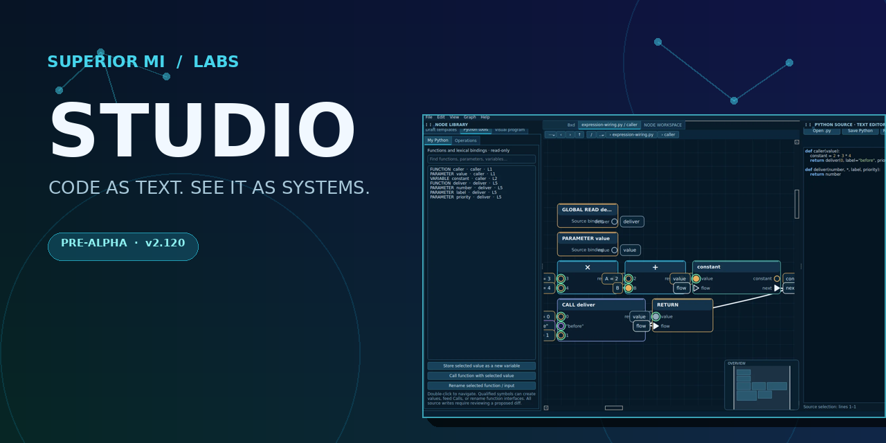
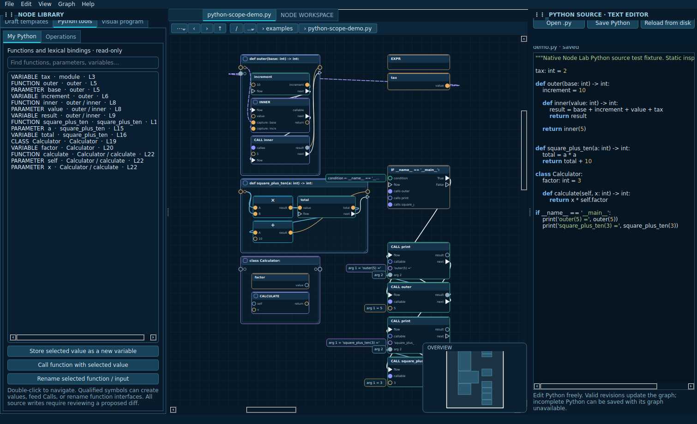
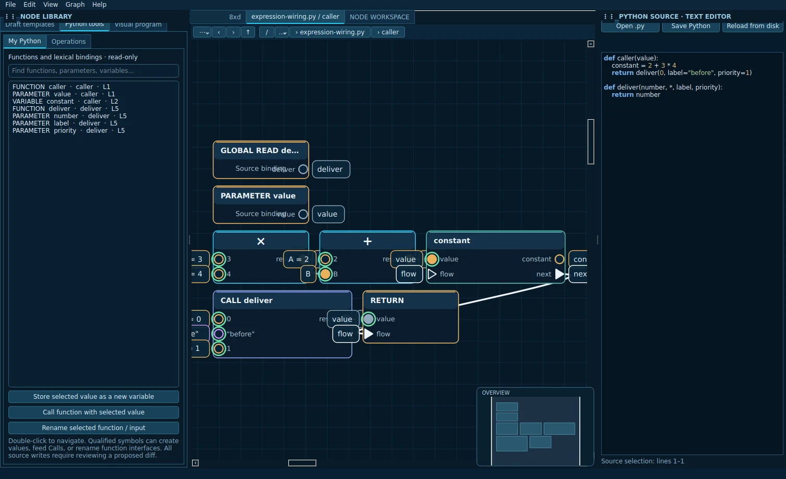
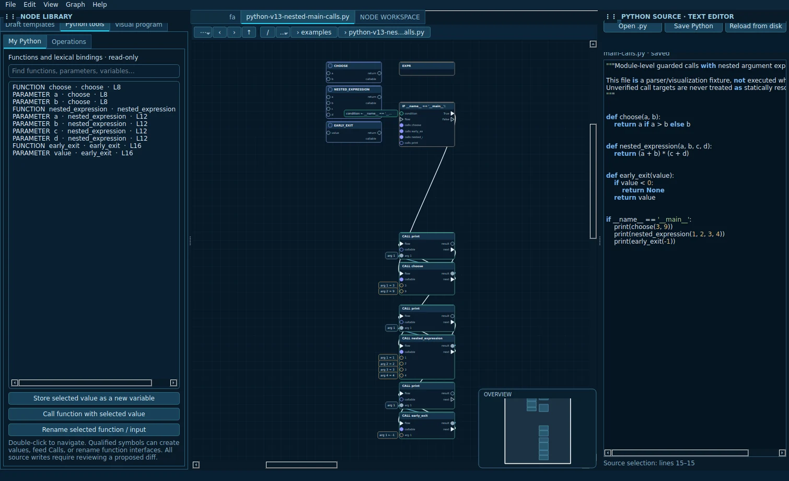

# Superior MI Studio

[**Explore the live website**](https://superior-mi-labs.github.io/Superior-MI-Studio/) · [Source](https://github.com/Superior-MI-Labs/Superior-MI-Studio) · [Roadmap](docs/PROJECT-ROADMAP.md) · [Contribute](CONTRIBUTING.md) · [Support](SUPPORT.md)



**A visual + text IDE for exploring, building, and understanding software.**

Superior MI Studio is a Python-first desktop IDE in development at [Superior MI Labs](https://github.com/Superior-MI-Labs). Our goal is one workbench where source code, editable node graphs, project files, and their relationships are connected, rather than separate tools with competing state.

We take inspiration from **VS Code's development workflow** and **Unreal Engine Blueprints' visual programming**, while designing Studio's own architecture and interfaces. We are not affiliated with either project.

**[Architecture](docs/architecture) · [Wiki](https://github.com/Superior-MI-Labs/Superior-MI-Studio/wiki) · [Development pipeline](docs/RELEASE-PIPELINE.md) · [Issues](https://github.com/Superior-MI-Labs/Superior-MI-Studio/issues)**

> **Current status: pre-alpha · v2.147 development candidate (GitHub CI and Linux Mint native pending).** v2.147 routes Save/Save As through the selected document rather than a legacy draft and reports graph changes if linked-source receipt refresh refuses after a commit. v2.146 passed GitHub headless and native Qt CI; v2.138 remains the latest uploaded Linux Mint host-qualified baseline (1,405 headless tests and native Qt PASS). Studio is not a stable release.

## The Studio workbench · v2.120 Linux preview

The images below are **real captures of the running PyQt6 workbench**, taken from a passing local native qualification report. Personal machine paths were redacted before publication. The screenshots show a development build, not a polished product release.

[](site/assets/studio-workbench.png)

| Typed graph connections | Connected Python project view |
|:--:|:--:|
| [](site/assets/studio-python-graph.webp) | [](site/assets/studio-project-view.webp) |

[**Open the interactive presentation website**](https://superior-mi-labs.github.io/Superior-MI-Studio/) · [Screenshot provenance and review process](docs/screenshots/README.md)

## What makes Studio different

- **Source and graphs in the same workbench.** Explore Python code visually, edit a supported native `ProgramGraph`, and generate qualified Python without silently overwriting the source document.
- **A connected project view.** Represent supported files and their observed relationships in graph presentations, with previews and shared navigation rather than a separate, incompatible file browser.
- **Trustworthy edits first.** Typed pins, execution/data flow, explicit diagnostics, revision guards, undo/redo, source preservation, and regression tests underpin development.

### Capability status

| Area | Status | What that means today |
| --- | --- | --- |
| Desktop workbench | Experimental | PyQt6 editor, tabs, dock panels, graph canvas, minimap, inspector, and navigation |
| Python visualization | Experimental | Source-to-graph analysis and presentation of supported Python structures |
| Visual authoring | Limited, working subset | Editable typed program graphs, structured control flow, verified graph-to-Python output, and conservative reconciliation with existing source |
| Project/resource graph | Experimental | Supported file previews, shared graph presentation, and evidence-backed resource relationships |
| Compiler, tests, debugger integration | Planned / foundational work | Extend existing diagnostics and qualification contracts; not a complete integrated toolchain |
| Languages, plugins, extensions | Planned | Architecture and capability contracts first; no public extension marketplace or general plugin API yet |

**Important:** Studio does not currently import and round-trip arbitrary Python. Unsupported or ambiguous source must remain source-owned or be rejected explicitly, never silently transformed.

## Try the development build

The current development workflow targets Linux; Linux Mint / Ubuntu / Debian users need Python 3 and PyQt6:

```bash
sudo apt update && sudo apt install python3-pyqt6
bash ./RUN-ALL.sh --headless    # Source, contract, and regression checks
bash ./RUN-ALL.sh               # Also qualify native Qt interaction offscreen
bash ./launch-linux.sh          # Explicitly launch the interactive workbench
```

Clone the repository (or download and extract its source archive), then run the commands from its root. `RUN-ALL.sh` collects logs and a compressed qualification report; it does not silently promote or install a new version. Windows launch scaffolding exists but is not yet release-qualified. See the [development and release pipeline](docs/RELEASE-PIPELINE.md) for candidate archives, host verification, and rollback.

## How development is qualified

**Source change + tests → headless qualification → native Qt interaction qualification → versioned candidate archive → host-specific review → release decision.**

Passing headless tests does not prove that the GUI or an end-user installation works. Unsupported syntax, conflicts, missing runtimes, failures, or timeouts must not be reported as a pass. The existing [release pipeline](docs/RELEASE-PIPELINE.md) is authoritative; we do not maintain a parallel publishing system.

## Where we're heading

**Now:** finish the large architecture/refactor pass, qualify the newest Linux build, consolidate Python compiler-proof logic, and preserve reliable document/graph ownership.

**Next:** mature Python visual authoring and source correspondence, improve diagnostics, and integrate task-running, linting, test execution, compilation/interpreter workflows, and debugging through stable contracts.

**Longer term:** extensible language adapters, file-type providers, extension/plugin APIs and manifests, cross-platform packages, build and debugger integrations, and a developer ecosystem comparable in scope of workflow to modern IDEs.

These are **plans, not released features**. The [roadmap](docs/PROJECT-ROADMAP.md) explains current priorities and boundaries; [AGENTS.md](AGENTS.md), [CODEX-START-HERE.md](CODEX-START-HERE.md), and [active engineering tasks](docs/agents/NEXT-TASKS.md) document how work is coordinated.

## We could use your help

Studio is a small independent research effort. Especially useful now: native Linux QA and real screenshots, Python/compiler architecture review, Qt UI/UX feedback, regressions, accessibility, documentation, and future extension design.

**Good places to start:** [native QA and screenshots](https://github.com/Superior-MI-Labs/Superior-MI-Studio/issues/1) · [compiler consolidation](https://github.com/Superior-MI-Labs/Superior-MI-Studio/issues/2) · [contributor help](https://github.com/Superior-MI-Labs/Superior-MI-Studio/issues/3). Please read [CONTRIBUTING.md](CONTRIBUTING.md) before proposing code. External code merges are on hold until licensing/contribution terms are published.

### Sponsorship, equipment, and paid development work

We welcome serious conversations about development sponsorship, hardware for testing, and help finding engineering collaborators. The developer is also available to discuss **paid Python, automation, AI integration, application, and developer-tool work** to support the project.

Contact: **superior.mi.labs@gmail.com**. See [SUPPORT.md](SUPPORT.md) for details. There is not yet an official donation checkout or claim of tax-deductible status.

## Project responsibility and licensing

Studio prioritizes source preservation, informed execution, explicit failure diagnostics, verifiable testing, and controlled changes. Security issues should follow [SECURITY.md](SECURITY.md).

**License:** No open-source software license has yet been selected for this repository. Public access alone does not grant permission to copy, modify, or redistribute the code. We welcome bug reports and design discussion while the licensing policy is being decided.