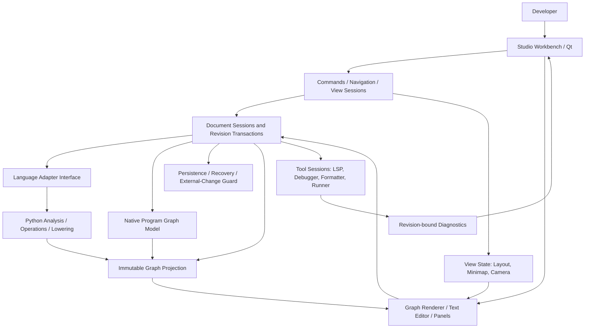
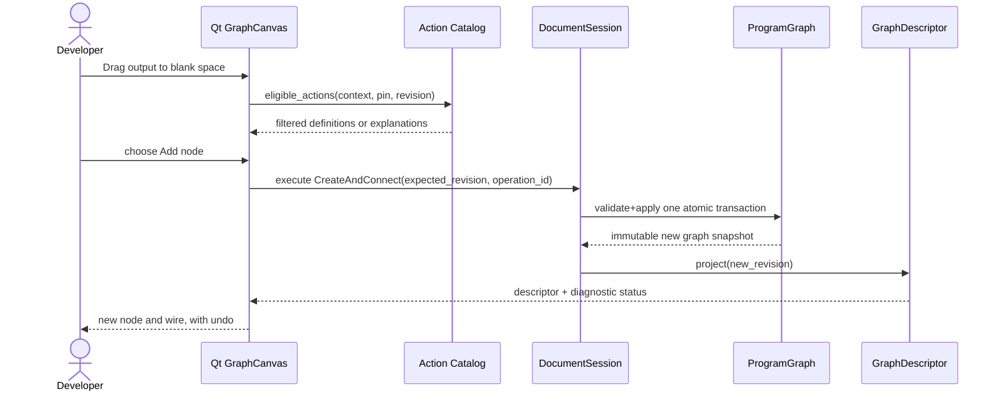
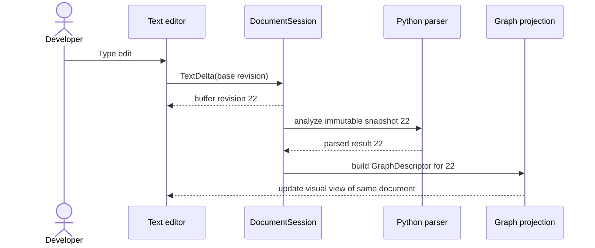
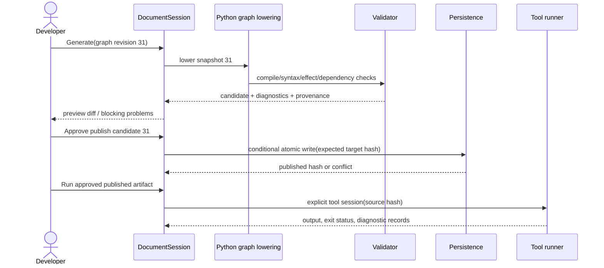

# Superior MI Studio — System and Subsystem Architecture

**Companion to Architecture Blueprint v3.1 | Revision 2026-10-30 | Status: target design, NOT implementation.**

## 0. How to read this document

This is an implementation contract, not a request to instantiate every box as a new class. The existing v2.50 implementation remains the baseline. A subsystem names one exclusive responsibility. Its implementation may be a current module, evolved module, or one new module justified by tests. Preserve compatibility while migrating. See `02-REFACTOR-AND-CLEANUP-PLAN.md` for exact current owners, change order, and stop rules. The central constraint is **one write authority per document/region, one semantic definition per operation, and one persistence path per artifact kind**.

## 1. Context and priorities

The product is a general IDE/workbench, not just a graph editor. It must support ordinary source editing, project/filesystem navigation, native graph-program documents, source-derived graph views, non-executable design graphs, multiple views/tabs, extensible language analysis, compiler/interpreter integration, project services, diagnostics, task execution, debugging, and later plugins. Node view styling is replaceable; program semantics are not. Everything is designed Python-first without letting Python leak into generic UI.

**Priority order:** integrity and non-loss > semantic correctness > stable contracts > usable interactions > performance > aesthetics. An attractive invalid or stale graph cannot masquerade as valid code. A complete draft must never be sacrificed to preserve a clean compiler result.

## 2. C4-style architecture overview



This diagram denotes allowed information flow, **not import requirements or threads**. The text editor and graph view are views of session-owned models. A source-owned document's graph is derived; a program-graph document's executable graph is authoritative and its Python source is generated. Opening a generated file for editing creates a separate text revision/branch for reconciliation unless the chosen import operation explicitly accepts the edit into the graph.

## 3. Layer boundary specification

| Layer | Owns | Reads | Never owns | Target implementation |
|---|---|---|---|---|
| Workbench/UI | Events, accessibility, focus, visible panes, gesture previews | View models and command results | Python semantics, file writes, program identity | Evolve `gui.py`, `docking.py`, `graph_surface.py` |
| Command dispatch | A single intent for each user action, contextual capability presentation | Document identity, adapter capabilities | Compiler rules or mutable graph copies | Evolve `authoring_actions.py`, `authoring_contract.py` |
| Document/session | Open document registry, live revisions, dirty state, transaction journal, undo grouping, conflict status | Content snapshots, persistence results | Language-specific code emitter, graph drawing | New minimal `document_session.py` when Phase 1 proves contract |
| Source model | Byte/text buffer, encoding, saved hashes, line mappings | Parsed diagnostics and edits | Direct Qt object lifetime, graph layout | Evolve `source_editor.py`, `PythonDocument` |
| Graph program model | Mutable versioned graph semantics: stable nodes, ports, scopes, edges, properties; incomplete states | Operation specs | Qt widgets, Python AST, node positions as semantics | New `program_graph.py` once Phase 2 approved |
| Graph projection | Immutable descriptions of each graph snapshot | Program model or language analysis | Mutable canonical state | Evolve `semantic_contract.py` |
| Python adapter | Parse, scope/symbol analysis, operation registry, validate intents, lower program graph, map source | Document snapshots and program graphs | Graph rendering or direct disk writes | Evolve `python_graph.py`, `python_authoring.py`, `python_edit.py`; add `python_lowering.py` only for true new responsibility |
| Persistence | Atomic publish, preimage checks, backups, crash recovery, schema migration | Accepted document snapshot/proposal | Deciding whether an expression is pure or legal | Reuse guarded writer for source, evolve graph persistence |
| Tool integrations | Tool process sessions, LSP/DAP/build/test adapters, output captures | Approved source revision and workspace config | Editing user source behind document service | Introduce only as tools added, Phase 7 |
| View state | Cameras, presentation positions, reroutes, collapse, selection | Stable semantic/source identity | Changing source behavior | Evolve `presentation_state.py`, `navigation.py` |

### Dependency direction constraints

- UI may import non-Qt contracts; **core/domain and language analysis may not import Qt**.
- The graph program model never imports `python_graph.py` or `python_lowering.py`.
- The Python adapter may import generic graph contracts, but graph contracts may not import Python AST.
- The renderer receives descriptors; it must never call code emission or disk writers.
- Persistence receives validated bytes/objects and expected base fingerprints; it never infers programming semantics.
- The adapter operation catalog is the one semantic registry. Menus, dialogs, pin gestures and keyboard commands derive from it, with context qualification.
- Navigation is bound to `(document_id, view_id, route)`; it never creates a second canonical buffer/graph.
- Historical draft prototypes, resource graphs and executable graphs share **presentation interfaces**, not executable semantics.

## 4. Domain identities (non-interchangeable)

`resource_uri`: canonical external file/resource reference; resolve aliases/symlinks consistently to avoid duplicate sessions. `document_id`: persistent UUID for graph documents, session stable identity for opened source; independent of a tab's identity. `view_id`: per-tab instance, can share one document. `revision`: monotonic session version, increasing even on undo. `content_hash`: checksum of canonical content snapshot. `saved_revision`/`saved_disk_hash`: last confirmed disk commit. `analysis_revision`: the source/graph snapshot an analysis describes. `generation_id`: unique generation proposal identity with `base_graph_revision`, adapter version, operation schema versions, settings, emitted hash and diagnostic set. `source_mapping_id`: identifies a specific generated/imported source-to-node correspondence. `operation_id`: semantic operation identity, distinct from translated title/icon. `node_id`/`port_id`/`edge_id`: stable graph-document identities; source-derived IDs may be revision-local and require conservative continuity matching.

**Rules:** Never use filesystem path as a view ID. Never use graph node presentation x/y position to determine program order. Never use source line number alone as a durable identity across edits. Never trust an old operation ID without version checking. Never apply an edit generated against revision N to revision N+1 without explicit proof/rebase.

## 5. Document model: five document kinds

`source`: normal text code; buffer is canonical, syntax can be invalid, graph projection can be stale/read-only. `program_graph`: native executable graph authored freely; serialized semantic graph is canonical, Python generation is derived. `prototype_graph`: existing `smi.dynamic-node-lab` UI-design data; not executable unless explicitly migrated through a semantic adapter. `resource`: filesystem representation; filesystem is authority and imported-reference wires are observations. `other`: future data/scene/animation/model/knowledge documents with their own authority; no obligation to use ProgramGraph.

A `DocumentSession` is a control-plane handle, not a second store of program truth. It points to exactly one canonical content object based on document kind. It is allowed to cache immutable projections tagged with revision, and to hold pending proposals/recovery information. It must never copy writable semantic graph state into Qt or into every view. A view maintains only local camera, selection, expansion, docking and transient interaction previews.

### Text state versus graph state

Source session: `SourceBuffer` may have invalid Python syntax, yet remains savable. Analysis emits current `GraphDescriptor` only if valid, or explicitly publishes last-valid snapshot stamped `STALE`; no source-qualified mutation against it. Program graph session: `ProgramGraph` may be incomplete, yet remains savable; validator emits independent structural diagnostics and semantic generation diagnostics. The generated source is an immutable output artifact tied to a qualifying graph revision; a hand-edited generated file is an independent source draft until reconciled.

### State facets

Use independent state fields, not a single enum: `dirty`, `analysis_status`, `generation_status`, `synced_base_revision`, `external_change_status`, `merge_conflict_status`, `run_artifact_status`. Example: graph can be `dirty=true`, `generation_status=blocked`, `last_good_generation=rev17`, and `external_change_status=none`. The UI must show which of those is current. Distinguish diagnostic levels: `error` blocks generation or publish, `warning` allows with disclosure, `info`, `unsupported`, `unreachable`, `stale`, `conflict`, `invalid_document`.

### Undo and publication are deliberately different timelines

A document's edit journal groups text edits or graph commands and restores the **canonical in-memory session state** at a new revision; undo/redo increments revisions and invalidates derived analysis/generation. Publishing `.py` is an explicit **external artifact transaction** with target fingerprint, backup and rollback record. A routine Ctrl+Z in a graph must not secretly roll back an externally modified `.py` file; provide an explicit "restore published artifact" command with the same preimage/conflict protection. The existing v2.50 committed-source undo history remains supported during migration, but its owner and interaction with new session undo must be made explicit and tested before consolidating shortcut behavior. Avoid one global undo stack pretending all file revisions are interchangeable.

### Generated-source view editing policy

The code panel showing graph-generated Python initially displays an **immutable generated snapshot** with revision banner. Starting a text edit forks a revisioned source draft (or activates an explicit "edit generated source" mode) and records the generation base. It does not mutate graph code behind the scenes. The user can request import/reconciliation, keep source branch, or discard the text draft with confirmation. A program graph and its generated source are never silently updated in both directions just because both views are open.

## 6. Canonical executable ProgramGraph: minimum form

Separate `program` from `presentation` in the serialized native document. The graph compiler reads the `program` section only; changing a color or reroute point must not alter generated code. Avoid a speculative universal AST. Begin with operations that lower into structured Python functions, preserving explicit control order, data dependencies, binding semantics and effects.

**Illustrative, not a final schema:**

```json
{
  "format": "smi.program-graph", "schema_version": 1,
  "document_id": "example-uuid", "language": "python",
  "program": {
    "module_id": "module-root",
    "scopes": [{"id":"scope-calc","kind":"function","name":"calculate","nodes":["entry","sum","ret"]}],
    "nodes": [{"id":"entry","operation_id":"python.function-entry.v1","scope_id":"scope-calc","properties":{}}],
    "ports": [], "edges": [], "declarations": []
  },
  "presentation": {"layouts":{},"view_defaults":{}}
}
```

An instance may be missing required input connections, have unknown symbols, be disconnected from execution, or contain design-only annotations. All must survive save/open. But invalid node references, duplicate IDs or corrupt schema are structural failures; recovery may quarantine invalid references without dropping their raw bytes. Unknown operation types must be retained as opaque data with a diagnostic, not silently discarded or executed.

### Node semantics

A node declares `operation_id`, schema version, scope, immutable identity, properties, typed role-labeled ports and optional source provenance. `input/output`, `control/value/effect/interface/reference`, cardinality and connection compatibility are adapter/schema contracts. **Value edges** denote dependencies; **control edges** denote explicit scheduling; a resource/import/reference relation does not imply executable control. A call's effect classification is `proven_pure | proven_effectful | unknown`; `unknown` may not be duplicated or reordered by optimizations. Blueprints' pure/impure distinction is a useful UI reference, not proof of Python purity.

### Structured control first, arbitrary sketching always

Free creation is unrestricted in the editor but **qualified lowering is deliberately constrained**. Stage 1 generator supports structured function entry/return, local assignments, primitives, binary expressions, qualified call sites, explicit statement order, and later `if/else`/bounded loops. Branches, loop bodies and function scopes have explicit structured ownership; graphical paths and layout do not define block nesting. Cycles only lower when represented by supported loop constructs. Unstructured control jumps, multi-entry regions, ambiguous joins and external mutable effects remain savable draft with clear diagnostics. Do not accidentally promise a general control-flow-to-structured-source compiler. Expand only when semantic acceptance tests prove soundness.

### Generation unit and dependency closure

The initial smallest publishable unit is a complete function with validated module-level dependencies, not an arbitrary connected subgraph. Generation may provide **preview-only** snippets for independent valid units even when the whole module is blocked. Publishing `.py` must be atomic and must satisfy closure: referenced functions/imports/constants, module top-level initialization, explicit entry behavior, and signature compatibility. Missing a required branch or reachable effect blocks its containing unit. A disconnected experimental node can remain graph-only **if the graph explicitly marks it excluded/draft and its exclusion cannot alter current executable behavior**. A potentially reachable or dependency-required invalid node is never silently omitted. Keep last-good published output unchanged on failure.

### Determinism/reproducibility

Given the same semantic graph, operation versions, Python target version and generation settings, candidate code + diagnostics must be deterministic. Presentational coordinates and tab states must be irrelevant. Generation captures target interpreter version, encoding, newline policy and provenance. Byte-identical output is a valid regression test for unchanged semantic input. Do not use graph mutation order or nondeterministic iteration to choose statement order.

## 7. Operation registry and graph schema API

One adapter registry supplies `operation_id`, version, pin/property schema, supported contexts, source-transform capability, graph-construct capability, lowering capability, validation rules, effect classification, documentation and keyword search metadata. All menus derive available actions from this registry, not handwritten duplicated `if kind ==...` chains. A generic connection preflight returns one of:

- `ALLOW`: exact legal edge, with no implicit source mutation unless action is applied.
- `REPLACE`: a specific old connection would be replaced (explicit preview/confirm policy).
- `TRANSFORM`: a named supported conversion or source transformation is necessary; user can see it.
- `REJECT`: stable machine code and human-readable reason, without graph side effects.
- `DEFER/UNKNOWN`: insufficient semantic evidence; graph draft may still record an intentionally invalid intent if format permits; no executable qualification.

Important distinction: **draft capture and legal semantic connection are not the same operation**. A user can sketch an unresolved link (e.g. to a not-yet-created input) only if stored as a valid intentional draft reference/placeholder; never corrupt the graph with dangling raw endpoints. A drag preview does not mutate canonical state. On release, a single transactional command either records a valid semantic edge, creates a clearly diagnostic unresolved sketch reference, or declines without side effects according to explicit user action.

All commands have `(document_id, expected_revision, operation_intent, target identifiers, options)`. Command responses include `new_revision`, `accepted_change`, `diagnostics`, `undo_group_id`, and optionally a source proposal. Prefer data contracts and function boundaries before abstract class hierarchies.

## 8. Interaction/event sequences

### 8.1 Visual node placement



The equivalent action on a source-owned graph uses the Python adapter's **proposed source transformation** against its live buffer; it may reject unsupported actions. Never turn a source view into an untracked mutable graph. Source and graph-owned views may have different authoring affordances but shared gesture language and command vocabulary.

### 8.2 Text change and valid unsaved projection



If revision 23 occurs before analysis for 22 finishes, result 22 must be discarded or stored as historical, never presented as current. When parsing fails, keep the text and last-valid graph distinctly labeled; disable semantic graph modifications against stale projections. Source save is allowed despite syntax error.

### 8.3 Graph generation, publish, run



If generation is blocked, last-good file stays unchanged. If graph or source revision changes between Generate and Publish, the candidate is stale; regenerate or rebase. Running never implies source save; a deliberate "run unsaved candidate" mode could exist later in isolated temporary files, but must disclose revision and security consequences.

### 8.4 Bidirectional reconciliation

For a graph-owned document with generated code, capture a shared sync base `(graph_revision, generated_source_hash, source_map_version)`. If the code is edited, retain that edited source buffer independently. On Sync, compare three versions (base, edited source, current graph). The Python adapter classifies changes: `importable`, `source-island-preserved`, `requires-ownership-switch`, or `conflict`. Apply an accepted import to **one new graph revision**, preserving stable identities where provable. Never choose a winner based solely on timestamps. If graph and source both changed the same mapped region, preserve both and require explicit resolution. Cross-region automatic merge must have tests demonstrating independence and no loss.

Importing arbitrary existing Python remains source-owned by default. Converting to graph-owned requires an explicit migration/import preview; some constructs may become opaque code islands. That limitation must be visible to users and to the agent.

### 8.5 External modification and crash recovery

Before disk write, compare expected path identity, content hash, applicable permissions and output revision. On mismatch, show compare/reload/save-as and retain in-memory edits. `Save Graph` uses versioned serialization plus atomic temporary-file/replace, backups/recovery policy and checksums. Recovery snapshots preserve content and provenance and are never confused with normal published user files. Untrusted JSON and source assets have explicit size/depth/operation limits. No file is executed merely by opening or analyzing it.

## 9. GUI and graph surface boundaries

Qt `GraphCanvas` owns camera transforms, event translation, transient drag/marquee state and drawing. `NodeItem`/`PortItem` render descriptors. `GraphSurfaceState`, `navigation.py`, `presentation_state.py` retain camera/graph navigation. Visual details including Bézier wires, reroute points, zoom, hover previews, edge layering, collapse, minimap, and selected-node stacking are view concerns. A node's program identity and port role are independent of whether it is compact, expanded, folded or rendered within a recursive composite.

**Default visual workflow:** function-focused workspace for readable programming; whole-file recursive canvas as overview/navigation. Retain the existing recursive graph surface engine, but do not make it the only authoring mode. Preserve existing distinct source/resource tab behavior. Document and tab lifecycle are distinct; an inactive view cannot dispose of a shared unsaved document. Source selection and graph selection use revision-aware source mapping; unicode offsets must be converted from Python's UTF-8 AST columns to Qt UTF-16 consistently.

**Immediate UX acceptance:** pin-drag into empty space offers compatible actions; eligible outputs actually initiate drag; disallowed wires show a reason; reconnection is one undoable command; deleting a source-backed node never just deletes a painted rectangle; isolated graph-owned nodes persist. Mixed pan, resize and selection gestures are qualified with native Qt tests. Accessibility/keyboard, focus, high-DPI hit targets and stable visual diagnostics are release criteria, not purely decorative later work.

## 10. Tools, extensibility, and security

LSP handles language-server features (diagnostics, completions, navigation, refactors) against a revisioned text document, not a second text file. The current published LSP site identifies 3.18 as latest; pin a specific protocol version during implementation after capability negotiation, rather than copying assumptions from an old specification. DAP is a future debugger adapter protocol; graph debugging maps runtime source spans back to current graph nodes only when provenance matches the running source hash. Compilation/build/test commands run in explicitly configured project environments and report the invoked command, executable, cwd, source revision, exit status and logs.

A future extension manifest may register commands, language adapters, tools, document kinds or render hints through stable contracts; **extensions do not directly mutate core documents**. Do not build an extension marketplace or remote plugin sandbox now. Trust boundaries: opening a project is not permission to run its setup scripts, import modules, start remote services, or execute node content. Parse JSON and Python AST without `eval` or implicit `exec`. Prompt explicitly before running potentially untrusted project tools. Avoid logging private source unnecessarily.

## 11. Performance, diagnostics and observability

Every asynchronous analysis or render result is tagged by `(document_id, revision, adapter_version, operation_registry_version)`; stale results are discarded. Profiling uses real corpus examples: cold open, warm parse, a source keystroke, a 100-node graph mutation, graph rendering/zoom/pan, graph generation and tool launch. Define service budgets based on measurements, not guesses. Avoid parsing the whole file on every mouse movement. Cache immutable snapshots keyed by revision where safe; derived caches may be dropped without changing semantics. Keep Qt main-thread UI duties bounded; background tasks must return immutable results and have cancellation semantics.

Diagnostic record: stable machine code, severity, source/graph range, originating subsystem, artifact+revision, explanatory text, recovery action and related evidence. One Problems view aggregates analyzers, compiler, LSP, persistence conflicts and user actions without conflating them. Node error icon is **not** permission to emit broken code. Support structured event logs with command IDs and revision hashes in qualification builds, but do not expose raw private source by default.

## 12. Readiness and release boundaries

The system must pass headless semantic tests **and** native Qt interaction tests. Existing source and graph documents must survive upgrade, downgrade/read-only recovery and failed validation without loss. New graph documents have explicit file format/version, bounded migrations and fixtures. Every phase is a reviewable vertical slice, not a wholesale application rewrite. No second real language adapter until graph-owned Python generation, existing-source parity, conflict behavior and GUI release gates pass. A mock adapter can prove UI neutrality before a second language.

## 13. Non-negotiable negative tests

1. Moving/recoloring nodes produces identical generated source bytes and hashes.
2. An effectful call whose result feeds two pins executes once, not twice.
3. An invalid reachable branch blocks publish; a detached explicit draft does not poison an unrelated valid unit.
4. Losing one view never loses another tab's unsaved document; stale parser completion never overrides current state.
5. Python source with CRLF, Unicode astral characters, comments, decorators and invalid syntax is not reformatted, dropped, executed, or silently rewritten.
6. Source file changed externally after preview refuses commit until diff/reconciliation.
7. Unknown operations and future schema fields survive safe read-only recovery, not silent deletion.
8. Old `smi.dynamic-node-lab` files reopen unchanged; their presentation controls do not become Python runtime operations automatically.
9. Editing a generated `.py` and concurrently editing its graph requires a proven merge or explicit conflict. Neither branch may disappear.
10. Runner/debugger reports the exact source snapshot/hash it executed; a stale graph display is never labeled as the current executing program.

## 14. Decision references

See `03-DECISIONS-DEFINITIONS-AND-NON-GOALS.md` for accepted ADRs and frozen vocabulary. See `02-REFACTOR-AND-CLEANUP-PLAN.md` for actual v2.50 code hotspots and planned cleanup. See `04-TRACEABILITY-AND-AGENT-EXECUTION.md` for module ownership, risks, ticket sequence, and evidence requirements. The master v3.1 blueprint remains governing for the full project vision; this document pins down subsystem contracts and interactions.
