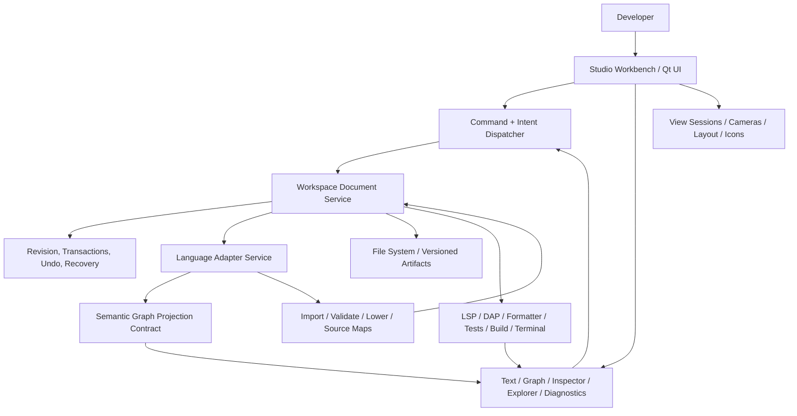
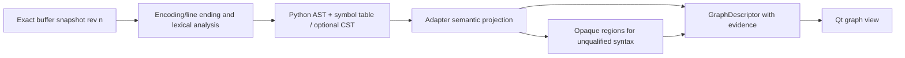

# SUPERIOR MI STUDIO — MASTER ARCHITECTURE BLUEPRINT

**Status:** Proposed target architecture / implementation handoff; **not** implemented in v2.50  
**Revision:** Architecture 3.0, 30 October 2026  
**Code baseline:** `Superior-MI-Python-Visual-Programming-Lab-v2.50.zip` (supplied archive, not an assumed current Git HEAD)  
**Mission:** A professional, extensible development studio where conventional text programming and native visual programming are both first-class, where incomplete visual designs can be saved, and where all semantic translation is explicit, testable, and loss-aware.  
**Intended audience:** Lead engineer, architecture reviewer, Qt/UI engineer, Python adapter engineer, test/qualification agent, later language/tool integration engineers.  
**Scope of this deliverable:** Design and implementation plan only. No application files were modified.

> **Architecture confidence and honest limits:** High confidence in the ownership rules, documents/views separation, safe persistence, staged Python-first work, and modular compiler boundaries. Moderate confidence in the exact smallest graph intermediate representation (IR) and synchronization granularity: these *must be proved* with a runnable vertical slice and adversarial examples. No honest engineer can promise complete round-trip equivalence for arbitrary future Python or every language without first defining a supported semantic subset and conflict-resolution policy. This blueprint treats those as measured engineering gates, not assumptions.

---

# PART I — PURPOSE, DECISION, AND PROJECT REALITY

## 1. The actual product we are building

Superior MI Studio is **not merely an Unreal Blueprint clone, a diagram application, or a Python AST viewer**. It is a future general development environment that can host source editing, native executable visual programming, architectural sketches, data/resource visualizations, and development tools, while offering a coherent user experience.

Required core experiences:

1. **Text-first:** Open existing `.py` projects without conversion, see source faithfully, navigate semantic graphs, edit the text, and run ordinary language tools. Incomplete or syntactically invalid text is still editable and savable.
2. **Graph-first:** Open a native Studio programming graph and create, disconnect, rearrange, group, or delete nodes freely, including incomplete sketches. Save and reopen *all* of it even when code generation cannot succeed.
3. **Interchangeable programming:** For a declared supported subset, visual authoring generates actual Python; corresponding text edits can be ingested back into the graph without semantic loss. Unsupported changes remain recoverable, with explicit diagnostics, source islands, or a switch of authority.
4. **Project-scale IDE:** Multiple files, explorer, tabs, source/graph side-by-side, functions, search, inspector, diagnostics, commands, debugging/testing/build integrations, optional extensions, and eventually language adapters beyond Python.
5. **Truthful feedback:** A drawn edge must not claim an executable relationship the adapter cannot establish. Unsupported, unreachable, unconnected, conflicting, dirty, stale, and invalid are *different* states.
6. **Long-term maintainability:** One active owner per artifact/region, stable contracts, one edit command path, no second hidden runtime, minimal Qt semantics, no ad hoc regex code generation, deterministic qualification.

**Non-goals right now:** Whole-language Python compiler reimplementation; automatic translation of *every* Python statement into arbitrary graph arrangements; runtime execution of the graph independent of Python; plug-in marketplace; multi-language execution; automatic semantic correctness proofs for dynamic Python; graphical prettification ahead of semantics.

## 2. Decision record: our chosen direction

### ADR-001 — A graph-first *capability*, not a single universal graph-first authority

**Accepted direction:** Extend Studio to support **both graph-owned programming documents and source-owned programming documents**. A document/region has exactly one semantic editing authority at any moment. They share a document service, semantic graph contracts, language adapters, editor commands, projections, source maps, diagnostics, and persistence rules. Synchronization is a versioned import/export transaction, not untracked two-way mutation.

This retains the strengths of both earlier approaches:

- **A (graph-owned):** Blueprint-like freeform authoring, independent `.smi-graph` persistence, partial validation, optional Python generation.
- **B (source-owned):** Conventional `.py` authoring, faithful source preservation, code-to-graph projection, bounded validated edits.
- **C (coordinated workspace):** Graph and text co-exist; for supported regions, synchronized interchange *feels* direct; for unsupported regions, clear ownership, code islands, and explicit reconciliation avoid silent loss.

**Why not choose pure A?** Existing arbitrary Python is richer than a practical visual node vocabulary. A graph compiler would either drop unrecognized semantics or have to represent source as opaque code. A full round-trip importer is extremely difficult, especially with decorators, dynamic rebinding, closures, exceptions, async, expression effects, formatting, and imports.

**Why not choose pure B?** Source-first authoring alone blocks legitimate graph-only sketches and forces every visual gesture to be immediately convertible to `.py`. That conflicts with the desired Blueprint-like creative workflow.

**Why not make both versions simultaneously authoritative?** Conflicting changes would race. Two mutable models of the same code are *two sources of truth*. Instead define ownership by document/region and a shared-base synchronization transaction. Users may keep different drafts simultaneously, but the system never silently declares them equal.

### ADR-002 — Save is not compile, generate, publish, or run

Explicit operations, each independently testable:

- **Save Graph**: Persist every well-formed graph *document*, including incomplete/unconnected programming content. Structural file validity is required; semantic completeness is not.
- **Save Source**: Persist the current text buffer, even if Python syntax is currently invalid, after protecting against stale/changed disk state and preserving encoding. This is what a real text IDE must do.
- **Analyze/Validate**: Return structured structural, semantic, source, and tool diagnostics without running user code.
- **Generate/Preview**: Produce candidate Python for independently qualified units. Candidate may be blocked, partial, or complete; never silently overwrite an existing valid program.
- **Publish Generated Source**: Explicitly approve a complete, validated, revision-matched candidate for a target file or declared compilation unit. No destructive fallback.
- **Run/Test/Debug**: Explicitly invoke a trusted toolchain on a specific source revision. Editing or analyzing never executes user code.

The current saved graph must be allowed to be invalid **as a program**, but not malformed **as a document**. Broken references are recorded as diagnostics/recovery entries, not silently serialized as if valid links.

### ADR-003 — Program scheduling is semantic, not geometric

Node X-position, vertical arrangement, stacking, tab/camera locations, collapse, and reroute points **never determine execution order**. Only explicit control structure and adapter-proved dependencies do. This is non-negotiable.

### ADR-004 — Python first, but neutral presentation contracts

The first executable graph target is a bounded Python vocabulary. Graph/document infrastructure must be neutral to syntax and runtime, but it must not invent fake universal semantics. A mock language adapter can test neutrality; a second real language is deferred until Python gates pass.

### ADR-005 — Preserve the successful v2.50 infrastructure

Consolidate and evolve existing modules. Do not replace the Qt application, scene graph, graph descriptors, navigation, resource explorer, source writer, authoring catalog, or test suite without a demonstrated need and migration test. Refactor along proven responsibilities; **do not turn the migration into a rewrite for its own sake**.

## 3. What v2.50 demonstrably contains

**Evidence method:** Inspected the supplied archive, selected source and documentation files, and executed `python3 -m unittest discover -s tests -p 'test_*.py' -q`: **606 tests pass** locally. PyQt6 is unavailable in this execution environment; therefore **native Qt smoke and real GUI behavior remain unverified**. Historical package documentation reports host-level passes for earlier builds but does not qualify the uploaded v2.50 on the user's current host.

| Area | Current system / module(s) | Strength to retain | Gap relative to target |
|---|---|---|---|
| Native draft state | `studio_native/model.py` | Mutable, persistent JSON graph draft, stable generated draft IDs, basic typed ports, atomic *in-memory* candidate transactions | Explicitly presentation-only; current node content is not executable language semantics; prototype limits and save behavior must evolve |
| Shared descriptor | `semantic_contract.py` (`GraphDescriptor`, `NodeDescriptor`, `PortDescriptor`, `EdgeDescriptor`, interfaces, exits) | Read-only normalized source/draft/resource projection; contract guards semantic/presentation mixing | No canonical editable program IR or runtime-specific lowering contract |
| Source importer | `python_graph.py`, `PythonDocument` | AST + symbol-table source projections, function/loop/branch/call/binding modeling, source evidence, conservative opaque cases | Reads saved path on construction; no live invalid-buffer model; positional IDs vulnerable to source movement |
| Visual source edits | `python_authoring.py`, `python_edit.py` | Qualified AST transformations, scoped refusals, reviewed diff proposals, source backups | No general graph-owned compiler; source changes require valid result and disk writes |
| Edit capabilities | `authoring_contract.py`, `operation_catalog.py`, `authoring_actions.py`, `source_connection.py` | Source adapter advertises actions; connection preview uses real proposal | Capability/operation metadata is distributed; Qt gestures partly filter differently from backend; no single cross-mode graph edit contract |
| Source UI | `source_editor.py`, `gui.py` | Qt source editor, UTF-8 byte to Qt UTF-16 span conversion | Unsaved changes held separately; invalid source saves prohibited; graph blocked while dirty |
| Rendering / viewport | `gui.py`, `graph_surface.py`, `graph_layout.py`, `edge_presentation.py`, `exit_routes.py`, `boundary_edit.py` | Node/pin/edge rendering, pan/zoom, selected nested camera, minimap, edge visuals | `gui.py` aggregates many roles; direct manipulation is incomplete; relation-specific rendering should be declarative |
| Navigation | `navigation.py`, `graph_routes.py`, `docking.py` | Routes, view sessions/history, cameras, tabs, dock state | Extend routing for graph-owned programming documents without duplicate controllers |
| Presentation persistence | `presentation_state.py`, `python_presentation.py` | View appearance separate from source semantics | Node identity remap and independent graph-owned spatial view state still require design |
| Resources | `resource_graph.py`, `source_associations.py` | Filesystem/resource graphs and source relationships | Preserve as resource *view*, not a second programming graph compiler |
| Tests/qualification | `tests/`, `qt_smoke.py`, `RUN-ALL.sh`, `doctor.sh`, `scripts/python-first-gate.py` | 606 headless tests, prior host smoke framework, timeouts/diagnostics, safe install patterns | Must qualify actual GUI and new source/graph persistence, migration, crash recovery, conflict cases |
| Visual assets | `assets.py`, `external_icons.py`, packs, icon styles | Optional icon/atlas visual integration | Keep icons/visual manifest independent of executable node semantics |

**Important exact limitations:** `model.py` says its content is prototype presentation data, not Studio runtime semantics. It has `smi.dynamic-node-lab` format/version 1, a 4 MB file bound, 150-node / 1200-edge bounds, and currently writes JSON directly. `PythonDocument` reads file bytes and parses them before producing source graphs. `source_editor.prepare_source_change` rejects invalid syntax. `python_edit.apply_proposal` checks stale bytes, creates backups and uses an atomic replace *per file*, but explicitly does not establish cross-process compare-and-swap/locking. `SourceEditHistory` is bounded and in-memory. `graph_routes.resolve_graph` handles only qualified `source` and `resource` routes. These are **current facts, not promises about the target design**.

## 4. Unreal and conventional IDE architecture: what to borrow

Unreal's `UEdGraph`, `UEdGraphNode`, `UEdGraphPin` and `UEdGraphSchema` separate graph objects and pin/connection rules; its action database is separate from menus; connection-drawing policy is separate from connection legality; and `FKismetCompilerContext` lowers graphs through compiler stages and per-function contexts. Blueprint's compilation can prune unscheduled nodes; it is not a license to discard a function's required but broken dependencies. The Unreal model also recognizes pure vs. impure operations, whose evaluation differs. References are in Part XII.

Borrow:

- **Graph structure:** explicit graph IDs, node IDs, port IDs, function interfaces and versioned graph schemas.
- **Edit policy:** schema-driven connection responses, contextual actions, eligible conversions, typed pins, precise diagnostics.
- **Editor widgets:** distinct node/pin widgets, wires, hover, reroute, collapse, navigation, contextual creation, selection, graph refactoring.
- **Compiler discipline:** per-scope validation, scheduling, dependency/liveness analysis, intermediate lowering, generated output and source maps.

Do *not* copy:

- Unreal's assumption that the graph is the complete programming asset for all programming tasks.
- A second custom bytecode runtime when Python is already the target runtime.
- Pure functions inferred merely because a node lacks execution pins.
- Unreal engine object/reflection/class machinery, which is specific to game development.
- Visual graph coordinates as a control-flow language.

From VS Code/LSP/DAP patterns, borrow versioned in-memory text buffers, workspace commands, diagnostics, tools as separate services, extension permissions, and language-specific tooling. **Do not copy their Electron implementation as an architectural prerequisite.**

---

# PART II — TARGET SYSTEM BOUNDARIES AND OWNERSHIP

## 5. System context and component architecture



The arrows describe conceptual dependencies, **not a mandate to add one Python module for every box**. The first implementation should evolve the existing ownership boundaries into these capabilities.

### Dependency rules

1. Rendering/UI depends on `GraphDescriptor`, command/qualification results, route/session state and presentation metadata. **Core document/adapter code must never import PyQt6**.
2. Document service knows file identity, buffer revisions, ownership, persistence, and event history. **It does not parse Python syntax itself**.
3. Python adapter knows Python AST/symbols, language-specific graph semantics, code islands, effect constraints, compiler validation, and lowering. **It does not paint nodes or own canvas cameras**.
4. Graph-owned program model owns graph nodes, pin instances, connections and semantic scope hierarchy for an authoritative `.smi-graph`; the read-only `GraphDescriptor` remains a **projection**, not a second writable registry.
5. Source-owned document model owns exact text buffers, including invalid syntax. Its graph is a derived projection; graph edits are adapter-authorized source transactions.
6. Tools run only via explicit commands or controlled analyzers; opening, rendering, indexing or validating never executes imported Python code.
7. Resource graphs can share presentation and navigation but not assume executable graph ownership.

## 6. Ownership matrix — eliminate two sources of truth

| Information | Canonical owner | Derived consumers |
|---|---|---|
| Unsaved text in `.py` | In-memory text document | Syntax analysis, source projection, LSP |
| Source file bytes on disk | Persisted version of text document, with external-change identity | Reopen/recovery; **not** competing live UI buffer |
| Graph-authored program nodes/wires/scope | Native graph program document | Semantic snapshot, compiler, renderer |
| Imported source-owned nodes/wires | Parsed text snapshot at a known revision | Graph renderer; never independently mutable |
| Generated Python from graph | A generated artifact tied to graph revision and mapping | Text view, runtime/tooling after explicit publish |
| Hand edits to generated Python | Independent text draft, pending reconciliation | Importer/merge proposals; no silent update to graph |
| Node positions, reroutes, colors, cameras | Presentation state keyed by document/view/semantic identity | Renderer only |
| Operation definitions and Python rules | Python adapter + versioned operation definitions | Catalog, schema, compiler, inspector, tests |
| Active document/view routing | Workspace document service + existing navigation sessions | Tabs, breadcrumbs, back/forward |
| Diagnostics | Analysis/tool output tied to a document revision | Problems panel, badges, node annotations |
| Build/test/debug observations | Tool session and source revision | Run panel, debugger, optional runtime overlays |

**Regional ownership:** At the first implementation stage, ownership is **whole document**. Add function-level/region-level ownership only after proven source mappings and conflict-resolution tests. Do not begin with arbitrary mixed ownership on individual expressions: that multiplies sync states and creates untraceable patches.

## 7. Document kinds, identity, and lifecycle

Use a single document-service abstraction whose document kinds may vary:

- `source`: `.py`, eventually other languages. Canonical exact buffer with revision; source graph derived.
- `program_graph`: native executable visual program artifact, proposed `.smi-graph` format. Canonical graph with revision; generated `.py` derived.
- `prototype_graph`: existing `smi.dynamic-node-lab` data: non-executable node prototype or visual design artifact. **Keep compatibility**; do not misrepresent it as executable.
- `resource`: filesystem-backed resource visualization; filesystem is authority.
- `other`: future data, diagrams, AI development tooling, UI designs, animations and asset workflows; own document formats and adapters.

**Stable IDs:** `document_id` is an internal UUID (persist graph docs; maintain workspace/session mappings for files). `resource_uri` identifies a file. `view_id` identifies one open tab/view, which may have its own route and camera. `revision` is a monotonic in-memory integer for that document session; hashes identify content across reloads/processes. An open file shown in two tabs remains *one buffer*, not duplicate unsaved versions.

**Lifecycle:** discover/open → load bytes/graph → validate *file structure* → create revisioned in-memory document → create one or more views → analyze/projection → edit transaction → dirty state → save/check external changes → close/recovery. Closing one view does not discard another view's unsaved document. Crash recovery captures both graph and source drafts with enough provenance to restore or compare.

**Revision constraints:** Proposed edits include `base_document_id`, `base_revision`, and `base_content_hash`. A change can commit only against that exact base, or through an explicitly verified rebase. Revisioned analysis results must not paint onto a newer document as if current.

## 8. Authority and synchronization state machine

A document/region is not merely “synced” or “not synced.” Track at least:

- `graph_current`: graph saved; generated source revision matches graph.
- `graph_dirty`: graph changed since last save.
- `generation_outdated`: graph changed since last successful generation.
- `generation_blocked`: current graph unit has blocking diagnostics; last valid output retained.
- `text_current`: source text working buffer and source graph projection match the same revision.
- `text_invalid`: source text exists and is writable; current full-source parse/projection unavailable or partial.
- `source_draft_diverged`: generated text has been independently hand-edited since mapping base.
- `graph_draft_diverged`: graph has changed since the same mapping base.
- `merge_conflict`: both graph and text changed overlapping mapped regions; preserve both, require resolution.
- `external_change`: disk content differs from session's saved hash; compare/reload/merge.

These are **derived facets**, not one giant nullable enum: graph dirty and generation blocked can be true together. Centralize derived status in the document service and show concise UI indicators. Each displayed graph snapshot must identify its analyzed revision; stale graph should be visibly marked.

---

# PART III — GRAPH PROGRAMMING MODEL

## 9. Canonical model: three different graph concepts

Do not conflate:

1. **Authoritative ProgramGraph**: editable program operations, scopes, links and incomplete placeholders stored in native graph documents; new capability to introduce.
2. **Semantic GraphDescriptor**: immutable common projection used by renderer/inspector; already implemented; extend carefully with optional metadata when necessary.
3. **Presentation graph**: layout, camera, collapse, bounding rectangles, wire route controls, grouping and icon references; existing view/presentation owners. Not executable.

A resource graph is a fourth *document kind*, not an executable ProgramGraph.

### Minimum ProgramGraph elements

| Element | Required fields | Invariants |
|---|---|---|
| Program document | `format`, `schema_version`, `document_id`, `language`, `language_version`, `revision`, root graph ID, definition references | Version validation and migration; no silent unknown destructive rewrite |
| Scope/graph | Stable graph ID, owner (module/function/explicit region), declared interface, list/order of node refs | No cycles in **ownership** tree; control-flow cycles permitted when valid |
| Node | Stable node ID, `operation_id`, `operation_version`, scope owner, parameter/property values, port instance IDs, optional syntax island refs | Node semantics come from operation spec; label/icon never defines behavior |
| Port | Stable ID, semantic role (control, value, binding, effect, interface), direction, type expression/unknown, cardinality, default state | Types can be unknown; UI color is not semantic type information |
| Edge | Stable ID, port endpoints, relation, diagnostic status | Referential consistency; no fabricated edge just to pretty-print an outline |
| Interface | Parameter inputs, entry control, return outputs/sites, versioned signature | Definition site and call site are distinct nodes; propagate changes through qualified rule |
| Draft marker | Incomplete/disabled/inactive/unreachable/unsupported status | Draft content persists; status affects generation, **not file save** |
| Provenance | Origin node/source-ref IDs, source mapping revision, optional effect/binding evidence | Uncertain mapping must be marked uncertain |
| Metadata | Human annotations, comments, labels, groups, optional visual intent refs | Metadata cannot override executable semantics |

**Do not store renderer-specific `x`/`y` directly in canonical executable node semantics unless a well-defined separate layout section is used.** A native graph file can contain both `program` and `presentation` sections, but the compiler must read only `program`, and changing presentation cannot change emitted code hashes.

### ProgramGraph is not a universal AST

An operation represents programmer intent in a supported language. A generic node can express an operation family such as `branch`, `call`, or `return`, but Python-specific semantics stay in the Python operation implementation. Use stable IDs such as `python.call.v1`, `python.return.v1`, `python.binary.add.v1` or adapter-defined IDs, not UI strings such as `Pretty Green Add Card`.

Do **not** use a single global `type` enum for all languages. Keep language-qualified types (`py:int`, `py:unknown`, future `rust:i32`, etc.) and use explicit compatibility outcomes. Python `int` is not `i32`; annotations are not runtime guarantees.

### Node instance vs operation definition

- **Operation definition:** describes node family, pin templates, property schema, language, purity/effect assumptions, supported graph ownership and lowering implementation, and compatibility rules.
- **Node instance:** identifies an actual operation on a graph, its pin IDs and properties.
- **Rendered card:** visualizes the instance; may collapse, reorder visible rows, or show icons without altering program meaning.

This separation should build upon `authoring_contract.py`/`python_authoring.definitions()` and `operation_catalog.py`; refactor toward **one adapter-owned registry** rather than having independent lists for the renderer, catalog, validator and generator. Existing source-qualified operations may need new capability markers to distinguish `source_transform` from `graph_construct` and `graph_lower`. Avoid retroactively claiming that all 19 currently source-qualified operations can compile arbitrary graph instances.

## 10. Pin roles, connections, and the schema

Define semantic roles explicitly:

- `control`: happens-before/execution successor structure.
- `value`: a value produced/consumed, with a declared type or `unknown`.
- `binding`: name/lifetime/reference identity where necessary (not equivalent to expression copying).
- `effect`: side-effect ordering/dependency evidence; must not be treated as ordinary data.
- `interface`: function/subgraph boundary relationships.
- `observation`: import/reference/contains/resource association; **not editable execution** unless adapter explicitly supports a corresponding operation.

Connection policy returns structured results: `allow`, `allow_replace`, `requires_explicit_conversion`, `allow_draft_with_diagnostic`, `deny_structural`, `unsupported_by_adapter`. Crucial distinction: a graph document may store **incomplete or semantically suspect** links for experimentation, provided they are structurally valid and persist with diagnostics; a source-backed graph edit may not rewrite `.py` until the adapter generates a safe proposal. UI communicates both an edit's graph-level legality and code-generation support.

Structural integrity failures include missing referenced IDs, duplicate IDs, corrupted port payload, unknown critical schema version and illegal container ownership. These block *normal publishing* of a graph file; where practical offer read-only recovery preserving raw bytes. Semantic problems (missing value, type conflict, incomplete branch, undefined function, unreachable node) remain savable.

**Existing `model.connection_error()` currently enforces matching type strings and occupied inputs for prototype connections.** Do not simply relax those guardrails in-place for all documents. Introduce a program-graph schema policy and migrate prototype behavior separately, preserving old test expectations.

## 11. Correct execution and value semantics

### 11.1 Non-negotiable Python distinctions

1. An impure call must not be duplicated if its result fans out to two consumers. Represent once-bound result vs copyable expression explicitly.
2. Python order of evaluation is meaningful: arguments are evaluated in order; short-circuit `and`/`or`, ternary expressions, comprehensions, generators and `await` have conditional/suspended evaluation semantics.
3. Branch merge, variable rebinding, lexical scopes, closures and mutation require deliberate modeling. A white exec wire alone does not prove variable dominance or safety.
4. `return` is a terminal transfer from a function; multiple return *sites* can coexist. A function's declared result interface is not an extra executable return statement.
5. `break`, `continue`, loop `else`, exceptions, `finally`, yield and async cannot be flattened to plain sequential arrows.
6. A Python expression may raise or call overloaded user-defined operators; mark purity as `verified`, `declared_assumption`, or `unknown`, not inferred from visual color.
7. A data edge is not necessarily a cached assignment; distinguish references to a stored value from re-evaluation of a pure expression or an effectful computation.

### 11.2 Recommended bounded Python graph vocabulary, in development order

**Tier 0, proof slice:** module and function definitions; typed/unknown parameters; literals; local binding; arithmetic/comparison; once-bound direct function call; explicit Return; straight-line sequencing; disconnected draft nodes; unresolved ports; code island placeholders.

**Tier 1:** conditional branch with both successors and explicit joining semantics, explicit `if/elif/else` representation, bounded `for`/`while`, `break`/`continue`, loop `else`, optional/keyword arguments, interface updates, alias/binding diagnostics.

**Tier 2:** container literals, attribute/subscript, imports, methods, classes, iteration, exception handling/finally, closures, comprehensions, generators, decorators, async; *add individually* behind qualification tests.

The UI may expose a generic draft node when an operation is unsupported, but **must not show that the adapter supports executable generation** until the operation has a tested lowering.

### 11.3 Control-flow intermediate structure

Do not write a source generator that simply walks screen-left-to-right or topologically sorts every edge. Introduce a bounded internal **control-flow representation** inside the Python adapter's compiler path (basic blocks or structured regions) with explicit branches, joins, loop headers/backedges and terminals, sufficient for the admitted subset. This is *compiler analysis state*, not a second editable program registry. Generate valid Python structured statements by reconstructing or maintaining a structured region tree. If a graph's control flow is irreducible or cannot be represented in structured Python without transforming meaning, fail that unit rather than fabricate code.

### 11.4 Liveness, dependency closure and partial generation

**Never decide “valid portion” by visual distance or only by whether a node itself has an error.** For each emission unit (first: whole function; plus module-level topological dependency checks):

1. Identify explicit entry and reachable control graph.
2. Calculate required value dependencies and binding/effect dependencies of reachable operations.
3. Check lexical validity, dominance, complete required input pins, successor paths, return/exits and target-language constraints.
4. Report blocking diagnostics at node and port IDs.
5. Preserve disconnected/unreachable experiment nodes in `.smi-graph`. The generator may omit them **only** if they are explicitly outside the selected executable unit's dependency closure and omission cannot change specified behavior.
6. If a required part is invalid, **block that function's emission**, or emit a clearly labeled non-runnable preview. Do not quietly remove the condition or generate a dangerous alternate path.
7. Before publishing a target `.py`, verify complete-file dependencies. If a valid function calls a blocked newly authored function, publishing as runnable is blocked unless the symbol resolves to an existing explicitly preserved implementation with compatible provenance.

**Default generation unit:** one *complete function*, with selected module-level definitions and imports validated as a publishing unit. This is deliberately conservative. Finer slices require evidence that region ownership and CFG/lexical boundaries can be preserved.

## 12. Code islands and unsupported source

A **code island** is an exact source span retained in its original text form when Studio cannot safely decompose or reconstruct it as editable nodes. It has explicit scope, source hash, language, analysis status, and declared input/output boundary evidence *when known*. It may be displayed as an opaque node, a code block, or a source panel.

- Code islands must **not** be treated as pure values by default.
- A code island containing unknown writes, imports, exceptions, `await`, `yield` or control transfers is an *effectful unknown region*.
- Do not auto-connect a code island into arbitrary graph flow on guessed edges.
- A source-owned document can always display an opaque read-only segment; nothing must be rewritten simply to render it.
- For graph-owned documents, a source island may participate in generation **only under a constrained, explicitly modeled boundary**. Otherwise retain it as a draft/non-generatable region until supported.

This prevents a fake “100% visual Python” claim while providing pragmatic interoperability with real software.

---
# PART IV — COMPILATION, IMPORT, TEXT/GRAPH SYNCHRONIZATION

## 13. Graph → Python compiler pipeline

This is the major new engineering capability. Name it a **Python lowering/generation pipeline**, not a Python virtual machine or an interpreter. It uses Python's standard parser/compiler to validate generated text; Python itself runs the program.


**Stage 0 — snapshot:** Freeze graph revision, operation schema versions, Python target version, options, and dependency documents. Never compile a mutable graph while Qt gestures continue changing it.

**Stage 1 — document structure:** Check IDs, ownership, references, format version, placeholder representation and operation schemas. A document can be a valid saved graph while having nonfatal semantic errors.

**Stage 2 — semantic/typing:** Resolve operation definitions, graph interfaces, parameter/local bindings, scope and declared type relationships. Unknown Python types are ordinary; only proven contradictions should be hard diagnostics. Dynamic calls may require warnings or unsupported outcomes.

**Stage 3 — CFG/effects:** Compute executable region and dependency closure; ensure deterministic scheduling for effects, appropriate control exits, branch/loop formation, and no double evaluation. Reject unschedulable/ambiguous connections in the required closure.

**Stage 4 — lowering:** Build a small *internal* Python-specific representation (structured statements and expressions with metadata). Preserve provenance from every operation to generated construct. Keep the representation ephemeral and language-owned. **Do not turn a shared `GraphDescriptor` into the compiler IR.**

**Stage 5 — emission:** Produce formatted, deterministic source only from qualified operations. Define one official generator style; generated text can use e.g. 4 spaces, explicit locals for effectful calls, stable function ordering and blank lines. Formatting must never depend on graph coordinates. Preserve exact source islands unchanged when qualified to include them.

**Stage 6 — verification:** Parse and compile with the requested/available target Python version without executing the code. `ast.parse` alone is insufficient; it can parse statements invalid in context. Run optional linter/type checker separately and label tool provenance. For programs with tests, run them only upon explicit Run/Test command and in a trusted workspace.

**Stage 7 — mapping:** Return source ranges, node-to-source IDs, warnings, suppression records, hashes of input graph and generated candidate, operation implementation versions, and compatibility status.

**Stage 8 — proposal:** Show a diff and destination. Publish requires base source hash to match; preflight must recheck disk identity and project trust. If candidate is blocked, keep the last successfully published `.py`, mark it stale, preserve all graph work, and present *exact* blocking IDs.

**Stage 9 — audit:** Reparse the generated source and compare supported semantic structure against the source graph projection: bindings, returns, effect counts, control edges, output values and function interfaces. These equivalence checks are necessary but not mathematically sufficient for arbitrary Python. Run semantic differential tests where possible.

### What “partial code generation” precisely means

**Allowed:** Emit qualified independent complete functions that have no unresolved required dependencies. May preview candidate files and list skipped graph-only experiments.

**Not allowed by default:** Overwrite the output module with half its old definitions removed; silently omit a branch guard; silently remove an impure node; generate placeholder `pass` or `None` in a live function when doing so changes behavior; replace a valid function with a broken body; silently drop an unsupported decorator or import.

**Publishing policy v1:** Entire candidate **module** must pass syntax/compile checks and all required dependency checks. Support function-scoped generation previews, but publishing either merges an independently qualified function into an existing module with a reviewed bounded diff, or publishes a fully qualified new module. For a blocked function, unchanged previously published code can be retained **only when provenance, signature and dependencies prove the retained implementation is still valid**, and the UI explicitly says the target is stale relative to the graph. This avoids the seductive but unsafe rule of “compile every green node.”

## 14. Source → Graph import/projection pipeline



For **source-owned** `.py`:

- The source buffer is always authoritative, even while syntactically invalid.
- On valid source, `PythonDocument` may update the semantic projection from the *current buffer snapshot*, not only disk.
- On invalid source, retain the editable text and diagnostics; show a clearly labeled last-valid snapshot or confirmed partial projection; refuse unsafe graph edits against stale source evidence.
- Do not autoformat or rewrite user source merely to view it.

For **graph-owned** `.smi-graph` plus generated `.py`:

- The default Python text pane is an **editable generated-source draft**, clearly labeled as derived from graph revision `r`; it is not silently authoritative over the graph.
- After a supported text change, the importer attempts an explicit graph transaction against the exact mapping base. If safely reversible, apply to graph, advance graph revision and regenerate source.
- If unsupported, preserve the text as an unsynced source draft. Offer (a) keep separate, (b) embed/convert a qualified source island, or (c) change ownership of the applicable function/document to source. Do not delete either side.
- A graph-first UX may automatically accept **unambiguous safe local imports**, as long as transaction and undo evidence are maintained. Nontrivial changes must be reviewed.

### Exact text preservation

Python `ast.unparse()` is not a lossless source round-trip. The existing Python AST is excellent for analysis, but comments, whitespace, literal formatting and some trivia require exact source/byte spans or CST-aware edits. Initially use bounded localized source transforms and exact provenance; conduct a small, measured LibCST experiment if general comment/format-preserving transformations become the critical bottleneck. Do not introduce both AST and a new CST pipeline across the whole product before tests show the need.

Ensure source encoding, LF/CRLF, Unicode UTF-8 AST byte columns vs Qt UTF-16 positions, missing final newline, PEP-263 coding cookies, tabs/indentation and formatters are covered by golden tests.

## 15. Bidirectional synchronization without silent loss

### 15.1 Three-way merge by provenance, not by pixel geometry

Every generated artifact records:

- `graph_document_id`, `graph_revision`, `graph_snapshot_hash`.
- `source_resource_uri`, base source hash/revision, target Python version.
- `generation_id`, adapter/compiler/schema version, generation options.
- Mapping of program/function/node/port IDs to source spans and structural fingerprints.
- Last synchronized common-base content identity.

When both sides are edited independently, compute changes relative to the common base:

1. Determine whether the edits affect disjoint qualified functions/regions and can be independently validated.
2. For a single changed source-owned function, import only if the importer can prove the mapping and semantic compatibility.
3. For graph and source changes to the *same* mapped unit, mark a conflict and preserve snapshots. Generate a comparison of base, graph candidate and edited source.
4. Never auto-select “latest timestamp wins”. If neither side can be safely merged, retain both drafts and require explicit keep-graph, keep-source, or manual resolution.
5. After successful merge, publish a new common mapping identity; invalidate older previews, diagnostics and source-map references.

**Initial granularity:** document for authority, function for comparison/import, node for diagnostic locations. Expression-level two-way merging is a later optimization, not a foundational requirement.

### 15.2 Source identity, renames, moves and mappings

Native graph-authored nodes receive persisted stable UUIDs. Source-derived projection IDs in v2.50 often encode scope and source position and can shift after edits. Preserve a distinct `source_node_fingerprint` and a **conservative continuity matcher** to retain UI state through edits, using scope, operation kind, structural path, symbol binding and token context. Never assume identical line numbers or text labels establish semantic identity. If multiple matches are plausible, drop continuity and explicitly report ambiguous reconciliation. Store generated source-map metadata **outside** user `.py` by default, so Studio does not inject noisy IDs into normal Python; consider optional inline markers only if a controlled experiment proves necessary and users opt in.

### 15.3 Examples that must be correctly handled

**Example A — clean graph→code:** Graph function `f(a,b)` with Add→Return produces `def f(a, b): return a + b` (format may differ). Source parses, compiles, returns expected values, and generated mapping points back to Add and Return.

**Example B — disconnected arithmetic:** A Multiply node with no operands is persisted in the graph. It does not appear in generated executable code; UI says `draft / excluded`, not `compiled`.

**Example C — broken guard:** Branch condition missing on a required path blocks the entire function. Existing safe published `.py` is not replaced with behavior missing the guard.

**Example D — single call two consumers:** `result = side_effect()` is emitted once; consumers refer to the stored result rather than calling the producer twice.

**Example E — text edit supported:** Source `a + b` becomes `a * b` in a mapped function. Adapter verifies supported structural transform and updates graph operator; undo can return both views to prior revision.

**Example F — text edit unsupported:** A user adds a decorator or complex `try/finally` unsupported by the importer. Studio retains the exact edited source, marks graph mapping diverged, and offers source ownership or explicit code island. It does not display invented execution wires.

**Example G — both sides edited:** Graph changed Return; source changed Return against same base. Conflict displayed and both revisions retained, not overwritten.

**Example H — invalid source during typing:** `return (` stays in text buffer and can be saved; graph shows last-valid revision and is visually stale. When syntax becomes valid, projection refreshes.

**Example I — branch/loop effects:** Codegen cannot rearrange an impure operation across branches, `finally`, `break`, or loop iteration just because the node was moved on screen.

## 16. Unified transaction and undo/redo model

Recommended *semantic* command path:

```text
User gesture / text edit
   -> Command{intent, document_id, base_revision, payload}
   -> Document service checks current revision and document kind
   -> Adapter validates/qualifies if semantics are involved
   -> Proposal{result, diagnostics, diffs, provenance, base_hashes}
   -> Apply one in-memory document transaction
   -> Update revision / undo journal / derived views
   -> Persist on explicit save; publish generated source separately
```

**Unify user-visible undo history at the document level.** For source-owned documents, normal typing and graph-based source transformations both edit the same live buffer and should participate in a coherent editor undo sequence; for graph-owned documents, graph commands and successful text imports should participate in graph semantic undo, with independently recoverable unsynced text drafts. Do not maintain separate competing Qt text undo and file-level graph undo that can silently replay out of order. The first migration can wrap existing undo histories and phase in unified commands for bounded operations; do not rewrite every Qt widget simultaneously.

Transactions must:

- Recheck revisions and target identities before apply.
- Be all-or-nothing for one document semantic state.
- Have deterministic forward and inverse operations or a versioned snapshot boundary.
- Preserve presentation edits independently of semantic edits, but allow expected UX undo grouping.
- Reject stale source maps and concurrent external modifications.
- Distinguish `undo unsaved buffer edit` from `revert a previously published file` in UX and recovery.

### Cross-file persistence reality

An atomic `os.replace` for a single file does **not** make a graph file, generated `.py`, mapping manifest, and recovery journal atomically committed together. Use staging and a **recoverable generation manifest**:

1. Save graph and buffer drafts independently first (or journal their snapshot IDs).
2. Stage candidate `.py` in same-directory temporary file; validate bytes/hash.
3. Recheck destination base hash and graph snapshot identity.
4. Atomically replace the target single `.py`; record output hash and generation ID.
5. Update sync manifest with completed generation identity.
6. On startup, detect manifest/file/hash mismatches and offer recover/finish/reconcile. Never assume all files were committed if the process died between writes.

Use fsync, permissions, durable backups/retention, symlink/hardlink and path security checks appropriate to host platform. For multi-file transactions, define explicit failure/recovery semantics instead of promising impossible whole-workspace atomicity.

---

# PART V — PERSISTENCE CONTRACTS AND EXTENSIBILITY

## 17. Native graph file format, sidecars and migration

**Proposal:** `.smi-graph` is a *distinct* language-capable document type, not a silent rewrite of the existing `smi.dynamic-node-lab` prototype JSON. Choose the final extension after a small usability review; what matters is a versioned, inspectable, testable format.

Illustrative shape (not final schema; agent must first implement schema tests):

```json
{
  "format": "smi.program-graph",
  "schema_version": 1,
  "document_id": "stable-uuid",
  "language": "python",
  "target_language_version": "3.x",
  "program": {
    "root_graph_id": "g-module",
    "graphs": [{"id": "g-module", "owner": "module", "node_ids": ["n-f"]}],
    "nodes": [{"id": "n-f", "graph_id": "g-module", "operation_id": "python.function.v1",
               "operation_version": 1, "properties": {"name": "f"},
               "ports": [{"id": "p-control", "role": "control", "direction": "out"}]}],
    "edges": []
  },
  "presentation": {"views": []},
  "extensions": {},
  "generation": {"last_successful_generation_id": null}
}
```

**Rules:**

- Persistent stable IDs generated once, never regenerated on serialize/deserialize.
- Deterministic sorting/serialization to minimize noise in version control, except where declared semantic order matters.
- Schema migrations are versioned, reversible where possible, and tested with fixture copies. Unknown future major schema must open read-only or refuse safely; never strip unknown critical fields and save over the original.
- Preserve all authoring states: disconnected nodes, disabled groups, annotations, unknown operation placeholders, source islands and diagnostics *inputs*. Compiler diagnostics themselves should generally be recalculated rather than treated as authoritative persisted semantics.
- The existing prototype `smi.dynamic-node-lab` must remain loadable as prototype data. Provide explicit *Import as Program Graph* for supported nodes only; unsupported node kinds remain design/draft, not silently executable.
- Do not use `pickle`, `eval`, arbitrary import or executable object hooks when reading artifacts.
- Document-level size/depth bounds are configurable and tested. A valid but large graph should fail gracefully with partial rendering, not crash or truncate silently.

### Generated artifact sidecar

`foo.py` stays an ordinary Python file. A proposed `.studio` project metadata area can store `foo.smi-map.json`-equivalent provenance and generation history, with project-level relative paths/URIs, document IDs, base hashes and node maps. The exact folder name is not essential until packaging decisions; avoid imposing hidden code comments or custom imports in Python output.

**File association policy:** A source file may be edited without Studio installed. On next open, hashes reveal divergence; Studio must never assume generated files are untouchable. If a source file has no valid sidecar, treat it as normal source-owned text, not as silently graph-owned.

## 18. Graph schema, operation manifest and language adapters

Use an **adapter-backed manifest/capability registry**; not a separate table of truth in the UI. The adapter reports for each operation:

```text
operation_id, version, language, category, display metadata
port/property templates, cardinality, control/value/effect roles
required preconditions, qualification checks, draft-save support
source-transform support, graph-lowering support, import support
supported language versions, constraints, diagnostics
```

A compact interface in prose:

- `parse_source(snapshot) -> SourceAnalysis | diagnostics`
- `project_source(analysis, view_query) -> GraphDescriptor`
- `describe_operations(context) -> OperationCapabilities`
- `qualify_graph_edit(graph_snapshot, intent) -> QualificationResult`
- `apply_graph_edit(snapshot, accepted_intent) -> new_graph_snapshot`
- `validate_program_graph(snapshot) -> Diagnostics`
- `lower_program_graph(snapshot, target) -> GeneratedSourceProposal`
- `import_source_delta(graph_snapshot, source_snapshot, mapping) -> ImportProposal | Conflict`
- `map_runtime_locations(tool_events, source_map) -> node/port overlays`

**Do not implement all methods up front.** Mark explicit capabilities unavailable and grow behind acceptance tests. `GraphDescriptor` (extended to recognize `program` origin) is the common read-only presentation object; imports/exports and semantic edit interfaces may use separate small typed contracts. Avoid overloading graph data with syntax AST classes.

### Future language proving strategy

Before implementing Rust/C++/JS, build a **minimal fake adapter** that projects a 3-node test graph and advertises no source emitter, to confirm Qt, document service and action menus do not hardcode `python`. When Python-first gates are green, implement a tiny second real *read-only* adapter with accurate diagnostics, then independently qualify emitted operations. Do not claim “language-agnostic compiler” simply because the descriptors have opaque string types.

## 19. Studio workbench and editor model

The eventual UI is a **workbench** containing documents and views, not `GraphCanvas` pretending to be the whole IDE.

### Services and ownership

- **Workspace/project service:** root folders, files, config, project search, file watches, trusted roots, workspaces.
- **Document service:** open buffers, document revisions, dirty state, external changes, save/recovery, permissions and transaction coordination.
- **Editor registry:** text editor, source graph, program graph, resource graph, inspector, future data/design editors; views request document snapshots and commands.
- **Tabs/routes/session:** reuse `navigation.py`, `graph_routes.py`, `docking.py`; support tabs/views with independent cameras and selection but one underlying document authority.
- **Command service:** unique command IDs and enabled/disabled reasons; same command invoked from menu, keybinding, context menu, pin-drop, palette or automation.
- **Diagnostics service:** aggregate adapter validation, language server, compiler, linter and runtime with source/node links and clear origin/severity.
- **Tool service:** LSP/DAP/test/build/formatter/terminal launched only through trusted boundaries.
- **Settings/theme/assets:** platform keys, node styles, icon atlas manifests and accessibility; no semantic operation registration in art packs.

### Core interaction goals

1. Start a node by choosing from context search, dragging from a pin, dragging from a symbol/variable browser, or using a keybinding; all route through the same capability inventory.
2. Drag endpoint: show qualified allow/warn/draft/deny explanation. An arbitrary draft link may be allowed to persist **without** claiming executable codegen.
3. Reconnect/disconnect/delete nodes and wires with transactional undo, and invalidate corresponding generation previews.
4. Inline port defaults and editable node properties are checked by operation schema; controls (slider/dropdown/toggle) are *presentation editors for properties*, not inherently runtime signal operations.
5. Make function-focused graph the default coding surface; whole-file graph remains overview and navigation. Explicit collapsed subgraphs/grouping are organization, not disguised Python `if`/`for` syntax.
6. Preserve separate function definition, function call, and function return/exits; native function interface propagation is a semantic transaction across call sites, not manually adjusting painted ports.
7. Provide wire reroutes, hover highlighting, alignment/snapping, comment boxes, minimap and selection; persist presentation only.
8. Keyboard and accessibility parity: focus traversal, selectable ports, names/roles, high-contrast palette, scalable text, undo/redo, search, no essential hover-only control.
9. Make errors actionable: click problem → exact node/port and source range; identify if defect blocks graph saving, codegen, publication, or only execution/tooling.
10. Support side-by-side source and graph tied to the same document+mapping revision with no surprise reload or unsaved change loss.

### Node and wire visual language

- White (or theme-defined) control wires only where real control semantics exist.
- Typed value wires with accessible non-color identification; unknown types explicitly indicated.
- Reference/import/resource relationships visually distinct from executable edges.
- Effects never inferred merely by absence of control pins.
- Dangling pins and incomplete nodes use warning decorations, **not** forced fake connections.
- A small stable contract maps graph/operation semantic roles to UI family and icons. The optional Visual Atlas is an asset provider, not an operation compiler plugin.

## 20. Tooling, extension system, and IDE maturation

Do **not** build custom compilers, linters, debuggers or language servers while reputable implementations can be integrated. Studio may integrate:

- Python interpreter selection, virtual environments, test runners and terminal/task execution.
- LSP for diagnostics/completion/navigation/rename; document version sync and stale-result dropping.
- DAP for breakpoints, stack inspection, variables, watches. Source maps allow graph overlays of *observed* execution, labeled when approximate.
- Formatters/linters/type checkers as optional tools, with explicit provenance, version and user configuration.
- Git version control integration later through workspace tools rather than custom repository format.

**Extension architecture:** Favor declarative manifests and a small set of stable contribution points (commands, languages, graph editor actions, operations, resource providers, diagnostics, assets) *after* the core contracts settle. External untrusted extensions/tools must not run in the Qt UI process with unrestricted file privileges by default; isolate execution and require explicit trust/permissions. Do not construct a plugin framework before internal adapters demonstrate stable contracts.

---
# PART VI — REFACTOR STRATEGY, MODULE MIGRATION, AND DELIVERY PHASES

## 21. Principles for refactoring the actual v2.50 codebase

We should refactor **when an existing ownership boundary cannot satisfy the new contract without duplicating authority**, not because a module is long or an ideal UML diagram contains another box. The goal is to *reduce net conceptual complexity*.

### Preserve first

- All 606 headless tests, existing source AST projections and read-only diagnostic evidence.
- Native graph/draft editing capabilities and existing draft file compatibility.
- Source transaction preimage checks, backups, UTF-16/UTF-8 handling, explicit diff review and stale refusal.
- Route/camera/breadcrumb/docking behavior; preserve minimap and nested viewport fixes.
- Qualified Python operations and their rejection cases, including effects, scope, rebinding, signatures, keyword arguments.
- Resource graphs and optional icon/atlas integration.
- Installer qualification, timeout diagnosis, crash logs, safe install staging; no overwriting previously working user installation on failure.

### Replace/evolve specifically

- Disk-only `PythonDocument(path)` as the sole Python analysis entry: allow **immutable in-memory source snapshots** while preserving path/encoding/provenance.
- Invalid-source save refusal in `source_editor.py`: separate *analyze* from *save*. Saving validly encoded text does not require successful Python parse.
- Independent Qt source dirty state vs source AST authority: move ownership into one document session.
- Prototype `model.py` as the *only* candidate program graph: preserve `smi.dynamic-node-lab`; add/convert to dedicated executable graph domain with deliberate versioned format and operation ownership.
- Duplicated eligibility checks in Qt (for example drag start) vs adapter: UI asks capability service, does not maintain hardcoded allowed source kinds.
- Source-graph-only `resolve_graph`: add a graph-owned provider case to existing route dispatch; do not create another view-router framework.
- Direct disk source edits as the only way to apply semantic changes: retain disk writer as persistence, allow versioned in-memory proposals first.
- `gui.py` combined responsibilities: gradually extract command handlers/document coordination to existing non-Qt owners when touching the relevant path; keep Qt as event/view layer. Do not split simply to chase LOC targets.

### Module migration table

| Current owner | First safe change | Eventual responsibility | Do not do |
|---|---|---|---|
| `model.py` | Keep prototype API; add conversion/export fixtures only | Remains prototype editor OR delegates new program-graph document data to a carefully named module | Mutate prototype controls into Python runtime semantics |
| `semantic_contract.py` | Add optional versioned graph status/identity fields only after tests | Immutable view contract across source/program/resource origins | Become a mutable graph registry, compiler or Qt model |
| `python_graph.py` | Add a snapshot-based analysis constructor/factory; path load delegates | Source importer, symbol resolution, Python-to-descriptor projection | Read Qt buffers or write `.py` |
| `source_editor.py` | Decouple syntax diagnostic from buffer persistence, preserve byte/UTF16 mapping | Source-edit conversion/line ending utilities for document service | Treat `ast.parse` as permission to save text |
| `python_edit.py` | Split proposal calculation from disk commit; preserve writer guarantees | Python local transform proposals + guarded per-file publication | Bypass existing backups or silently accept stale base |
| `python_authoring.py` | Classify operations by capability and reuse proven checks | Python-owned definitions, source transformations and later graph lowering | Add a separate competing operation list for the graph compiler |
| `authoring_contract.py` | Introduce small versioned intent/result types | Neutral authoring transaction vocabulary | Encode Python AST or UI colors |
| `source_connection.py` | Expose adapter-owned endpoint/source eligibility | Connection qualification for source-owned views | Paint a wire when the backend refused its semantics |
| `operation_catalog.py`, `authoring_actions.py` | Reuse one authoritative operation registry | Context/action projections for every view | Guess operations from painted node labels |
| `graph_routes.py`, `navigation.py` | Add new route kind with session compatibility | One graph resolver across document types | Instantiate a second route/camera store |
| `presentation_state.py` | Make ID+view scoped positions robust | Non-semantic layout and camera persistence | Change program compilation via layout |
| `gui.py` | Replace local eligibility lists with adapter results, bind shared buffers | Thin Qt UI/gesture handling and rendering orchestration | Put Python generation or external tool process logic in widgets |
| `qt_smoke.py` | Add graph-owned and dual-editor smoke scenarios | Native interaction qualification with watchdogs/logs | Count a Python unit test as native GUI evidence |
| `resource_graph.py` | Leave stable | Resource explorer and graph projection | Reinterpret imports/resource edges as executable connections |

**New modules should appear only for genuinely new responsibility.** A plausible minimal set is `document_session.py` (one shared buffer/graph session and revisions), `program_graph.py` (native executable graph state and serializer), and `python_lowering.py` (graph-owned Python compiler). A small mapping/reconciliation helper may be justified *after* the vertical slice. These are candidate boundaries, **not fixed filenames or an instruction to generate boilerplate architecture**. Consolidate existing source history functionality rather than creating parallel histories.

## 22. Multi-phase delivery program with exact gates

### Phase 0 — Freeze baseline, evidence, and architecture tests (mandatory)

**Purpose:** Know what works and what must not regress before altering authority.

**Tasks:**

1. Unpack v2.50 into an isolated worktree/branch; confirm it is the actual handoff baseline or explicitly rebase onto the real repository HEAD. Do not assume archived ZIP == current repo.
2. Run `python3 -m unittest discover -s tests -p 'test_*.py' -q` and `./doctor.sh`. Record test count, environment, interpreter, Qt version and failures. Do not delete unrelated user logs.
3. On the user's Linux host, run `./RUN-ALL.sh` or dedicated native smoke and collect logs/screenshots. Investigate any timeout/callback failure before architecture migration.
4. Record current graph/doc/source command ownership and all file writes. Generate a simple import/dependency map; identify Python/Qt imports and UI direct writes.
5. Create golden inputs: empty Python; regular multi-function file; Unicode/CRLF/comments; partial invalid Python; nested scopes; side effects; try/finally; async; generator; prototype draft file; resource graph.
6. Establish performance baselines (open, project, graph, camera, source projection, memory) on representative small and bounded large files. Record metrics, no premature targets.
7. Add architectural invariant tests: no Qt imports from core; no source writes from renderer; no parser invocation executing imported code; versioned source/graph identities.

**Exit:** All original tests pass; host Qt baseline evidence recorded or declared blocked; golden corpus and current dependency map saved; no mystery file writers. **No functional architecture change during this phase.**

### Phase 1 — One versioned source document service

**Purpose:** Make text editing actually first-class before adding graph authority.

**Tasks:**

1. Introduce an immutable `TextSnapshot` of current in-memory buffer with `document_id`, `revision`, exact decoded text, encoding, newline metadata, saved-file hash, dirty flag.
2. Move authoritative buffer state out of per-tab Qt booleans; multiple views refer to the same session.
3. Teach Python analysis to consume `TextSnapshot` with no disk read. Keep existing `PythonDocument(path)` as a compatibility facade delegating to snapshot analysis until tests migrate.
4. Separate `Save Source` from `Validate Python`: allow invalid intermediate source, preserving bytes/encoding and external-change guards. Warn appropriately; do not use syntax refusal to block saving.
5. Distinguish current semantic snapshot from last-valid snapshot and mark stale projections in graph view. Disallow graph-to-source edits against stale semantic mappings.
6. Make text edit and source-qualified graph edit both submit versioned in-memory proposals. Existing backups and atomic writer remain the only publication path; avoid two writer implementations.
7. Define an undo grouping strategy for typing vs semantic commands and verify editor focus/shortcuts.
8. Test two tabs on one file, close/reopen, invalid syntax, stale external edits, conflicting edits, Unicode, newline modes, and crash restoration.

**Exit demo:** Type a valid change without saving; source graph updates from working buffer. Type incomplete syntax; text remains editable/saveable, current graph is clearly stale and no visual edit overwrites it. Fix syntax; graph updates. Source graph operation updates the *same buffer* with correct undo/diff behavior.

**Do not proceed** if source data can diverge silently between tabs or if saving invalid text wipes comments/encoding.

### Phase 2 — Canonical executable ProgramGraph specification + prototype isolation

**Purpose:** Create a stable native programming document that supports arbitrary drafts without conflating prototype UI controls and executable semantics.

**Tasks:**

1. Design `smi.program-graph` schema version 1, operation instance identity, scope tree, pins, edge references, output status, presentation split and unknown-operation preservation.
2. Keep existing `smi.dynamic-node-lab` format compatible; add explicit import/migration when needed, not universal conversion.
3. Implement pure, Qt-free graph transactions: create/remove/move semantic node, set property/default, connect/reconnect/disconnect, add function/signature, annotate, with revision checks and undo.
4. Separate **structural** validation (must pass to save normally) from **semantic** validation (may fail; graph still saves). Represent missing required inputs as absent/placeholder pins, not corrupt references.
5. Add deterministic JSON serializer, version migration, unknown-field policy, read-only recovery mode, backup/atomic file write and bounded large-file handling.
6. Build `GraphDescriptor` projection from ProgramGraph using the existing semantic contract: **explicitly version/extend its current `origin = source | draft | resource` discriminator to include `program`**, update validation for program-specific source/provenance rules, and migrate consumers/tests rather than disguising executable program graphs as prototype `draft` graphs. No duplicate rendered node state list.
7. Add ProgramGraph route/document kind to existing navigation and tab service; verify independent cameras and common document identity.
8. Define and test operation registry shape; start with neutral operation family and Python-specific IDs in the adapter.

**Exit demo:** Draw a Function, Add, Return and disconnected incomplete Multiply; move, reconnect, delete, undo, save `.smi-graph`, reopen with identical semantic IDs, preserved drafts and view layout. No `.py` generated. Resource and source graph tabs still work.

**Do not proceed** if serialization changes node behavior, if graph edits are stored twice, or if presentation-only controls are accidentally executable.

### Phase 3 — Graph-owned Python lowering vertical slice (A1 feasibility gate)

**Purpose:** Prove native graph can be compiled safely to real Python.

**Bounded vocabulary:** Module → 2 functions → parameters → literal → local binding → one arithmetic/comparison → direct once-bound Call → Return; optional program entry stub. No general loops/exception/async yet.

**Tasks:**

1. Define Python operation instances once in adapter-owned registry, with property/pin contract and lowering support status.
2. Implement per-function CFG/structured emission for straight-line control, value dependencies, stored-call effects, exact call binding and Return semantics.
3. Produce explicit `ValidationResult` diagnostics referencing stable node/port IDs. Unknown types permitted with warnings; missing producer is blocked when required.
4. Emit a *proposed*, deterministic Python module and source map; parse + compile with Python, never execute on generation.
5. Track source destination base hash, graph revision, operation versions, generation hash. Show diff and publish through guarded writer.
6. Allow disconnected/suspect draft nodes to remain in graph. Qualify independence before excluding from emission. A required broken function blocks that unit and dependent publication.
7. Test runtime behavior only in explicit isolated test harness for known benign fixtures; test execution count of side-effect calls.
8. Verify generated source projected back by existing `PythonDocument` is structurally compatible for admitted operations.

**Exit demo (non-negotiable):** Build two callable functions **entirely in graph**, create a testable call chain, generate valid Python, run tests, save/reopen graph, then add a broken experimental node and confirm last valid published `.py` remains unchanged while graph saves. Demonstrate compiler diagnostics mapped to ports.

**Decision:** If the compiler needs screen geometry or duplicate operation registries, redesign that boundary. If correct scoped generation is impractical, retain graph-first as a *design* mode and suspend executable expansion until repaired. Do not hide failures with `pass`/`None` placeholders.

### Phase 4 — Text ↔ graph interchangeability vertical slice (A2 feasibility gate)

**Purpose:** Prove the promise of interchangeable editing for a bounded feature subset without conflicting authority.

**Tasks:**

1. Extend mapping manifest and graph revision identity; record common sync base and function-level provenance.
2. Permit manual edits of generated text in a versioned text draft. Keep draft even when Python invalid.
3. Implement **supported reverse operations**: change arithmetic operator, literal, direct Return expression, function parameter name, selected direct Call operands.
4. Apply successful reverse imports as graph transactions; preserve stable graph node IDs and presentation positions where unambiguous.
5. On unsupported syntax (decorators, dynamic binding, try/finally), preserve text and present conflict/ownership options rather than pretending to map.
6. Test same-function divergent edits, disjoint-function edits, stale maps, external edits, commented/unicode/CRLF source, undo, repeated save, crash and restart.
7. Optionally prototype LibCST on a *small matched corpus* if existing exact-span edits cannot preserve text. Compare complexity, correctness and maintenance burden before introducing dependency broadly.

**Exit demo:** Graph Add→Return, generated text edited to Multiply, graph updates; graph subsequently edited and text updates; unsupported text change survives exactly and graph becomes stale/diverged without loss; concurrent edits produce an explicit conflict.

**Decision:** Do not label the product 'fully bidirectional Python IDE' if only this subset passes. Publish a capability matrix and honest warning states.

### Phase 5 — Blueprint-quality node interactions

**Purpose:** Improve the user experience now that the underlying semantics are real.

**Tasks:**

1. Wire all creation entry points, pin compatibility, mouse gestures, keyboard commands and palette search to one adapter capability service.
2. Support undoable reconnect, disconnect, delete, inline property edits, entry/return interface changes for qualified graph docs; source-owned view operations remain bounded by adapter proposals.
3. Add pin-drag contextual suggestions, hover explanations for invalid connections, wire highlighting and reroute points. Preserve semantic edge endpoints when rerouting.
4. Provide function-focused default, whole-file overview, explicit comment boxes/collapsed groups, consistent tabs/breadcrumbs and camera behavior.
5. Refactor only relevant Qt event handlers to defer to command and session contracts. Improve accessibility and selection/keyboard tests.
6. Capture real screenshots/recordings on native Qt host and run human scripted workflows plus smoke tests.

**Exit:** User can build the Phase 3 program without opening a modal dialog per primitive edge, can understand every blocked connection, and can navigate/update text side-by-side without data loss. Native GUI smoke passes repeatedly.

### Phase 6 — Expand Python control flow and practical language coverage

**Purpose:** Grow from a demonstration to meaningful Python programming without violating semantics.

**Tasks, in order:** conditions and merges; loops with `break`/`continue`/`else`; advanced assignments; function signature changes across call sites; imports and module references; exceptions/finally; collections; methods/classes; decorators; generators and async. Each operation must have separately tracked *projection*, *graph authoring*, *lowering*, and *reverse import* qualification.

**Exit:** A published Python capability matrix with golden source programs, graph-first programs, round-trip expectations, explicit effect tests and host UI evidence. No blanket claim of full Python support.

### Phase 7 — Studio as a conventional IDE

**Purpose:** Expand ordinary project/text workflow alongside the visual editor.

**Tasks:** file creation/rename/move, project tree, multi-file search, syntax highlighting/diagnostics, LSP version sync, environment selection, terminal/task and test runners, formatter opt-in, DAP debugger, version control integration, workspace trust. Graph observations can follow verified source-map coordinates; runtime execution is user-triggered.

**Exit:** A real small Python project can be edited primarily as text or graph, tested, navigated, and debugged, with correct file/version safety. Editor infrastructure is not Python-hardcoded.

### Phase 8 — Extensibility and second-language readiness

**Purpose:** Prove neutral contracts and sustainable expansion.

**Tasks:** fake adapter test; a small read-only adapter for a second real language; manifest-driven command/language contributions; profiling and selective incremental analysis; security/permissions for external tool integration. Defer multi-language graph emission until its own language semantics are qualified.

**Exit:** Second adapter projects source through the existing renderer/document/session architecture without changes to Qt's Python-specific logic. New language-specific lowering remains an adapter responsibility.

### Release/handoff sequencing rule

Never start two phases that simultaneously mutate document authority or the file persistence pipeline. Parallelize only independent tasks (golden fixtures, UX research, diagnostic renderer tests) once shared API contracts are frozen. Each phase must land as one reviewable integrated slice with recorded regressions and rollback instructions.

---

# PART VII — QUALITY, DIAGNOSTICS, AND SAFETY

## 23. Semantic test strategy: not just syntax tests

A generated `.py` file passing `ast.parse()` or `compile()` is necessary but insufficient. Runtime behavior and source identity require their own bounded checks.

### Required test families

1. **Structural property tests:** IDs unique, edges reference real ports, graph ownership acyclic, schema migration no data loss, serialization deterministic.
2. **Authoring state tests:** incomplete inputs, disconnected nodes, disabled nodes, unknown operations, invalid type combinations, reconnect/disconnect/delete, undo/redo all save/reopen intact.
3. **Compiler golden tests:** expected generated AST/bytes for Tier 0/Tier 1; identical output from unchanged semantic graph regardless of layout; repeated generate idempotent.
4. **Semantic differential tests:** Graph-first program and equivalent handwritten Python evaluated on fixed input cases; compare outputs, exceptions, state mutations and call counts. Don't run arbitrary user code in core test runner without sandboxing.
5. **Effect tests:** calls exactly once, ordering preserved, branches short-circuit, loops count correctly, exceptions/finally and returns handled only when supported.
6. **Ownership/conflict tests:** text buffers across tabs, stale source map, external disk modifications, graph+text concurrent divergence, source island fallback, recovery snapshots.
7. **Source-preservation tests:** comments, encoding cookies, Unicode identifiers, escaped literals, CRLF/LF, BOM (if supported), indentation, no ending newline, long lines, formats.
8. **Presentation invariants:** camera/pan/collapse/reroute/color changes do not alter generated program hash or source projection semantic edge set.
9. **Security tests:** untrusted files never executed on open; path traversal, symlink/hardlink, malformed graph JSON, oversized files, unknown schema, plugin manifest, subprocess timeout.
10. **Native Qt tests:** actual pin drag, modal behavior, callback exception recording, keyboard shortcuts, multi-tabs, minimap, selection, viewport clipping, high DPI, copy/paste, input fields.
11. **Performance/regression tests:** large bounded graph/file, cold/warm parse, incremental edits, graph camera update, memory, crash and recovery time.
12. **Compatibility tests:** old `.smi.dynamic-node-lab` docs load, old `.py` remains byte-identical after view-only use, old presentation settings migrate or safely reset.

**Assertions must test invariants, not fragile screenshots alone.** Screenshots prove appearance; tests prove underlying identities and effects. A passing Qt offscreen process does not establish that all real user gestures work.

## 24. Diagnostics taxonomy and behavior

Every diagnostic contains `id`, `producer`, `severity`, `category`, `document_id`, `revision`, `graph_node_id?`, `port_id?`, `source_span?`, explanation, blocking stage and optional suggested fix. Separate statuses:

- **File structural error:** cannot safely deserialize/publish document. Preserve raw data and offer read-only repair.
- **Graph authoring error:** structurally saved but missing required input, invalid connection, unsupported operation, unresolved control join.
- **Code-generation block:** selected emission unit cannot generate semantically faithful Python.
- **Python syntax/compile error:** emitted/edited text is not valid Python; still editable and savable as text.
- **Lint/type warning:** informational or configurable severity; does not automatically invalidate executable syntax.
- **Runtime/test failure:** observed only after actual Run/Test, never inferred from compiler warnings.
- **Sync conflict:** graph and text diverged; preserve both; independent of syntax validity.
- **Stale observation:** diagnostic or graph derived from an older revision; show as stale or discard.

A red node should explain whether the user can save, generate, publish, or run. “Error” by itself is too ambiguous for a dual-authority IDE.

## 25. Persistence, permissions, and trust

- Never run imported Python simply to discover nodes, signatures or defaults; static analysis only, even when expressions look like literals.
- Explicitly confirm active interpreter and project trust before running code or arbitrary project tools; runtime worker separated from UI process. Resource limits and cancellation apply to analyzer/worker processes.
- Preserve user source files on parse failure, generator failure, transaction rejection, extension failure, or Qt crash.
- Refuse silent stale target overwrite. Do not rely only on timestamps; use hashes/identity checks.
- Maintain bounded backup/recovery policy and avoid uncontrolled accumulation of `.smi-backup` files, journals or huge logs. Keep a documented rotation/cleanup strategy with explicit safety rules.
- Use atomic file replacement *per file*, and a recovery manifest when multiple artifacts are coordinated.
- Do not allow a hostile malformed graph to allocate unbounded memory or import arbitrary modules on load. Parse JSON under size/depth limits; operation IDs are data, not Python import strings to execute.
- Keep extension permissions explicit; external icon atlas images/manifests are data assets and have no permission to execute code.
- Separate automatic static analysis from user-triggered Build/Test/Run/Debug in command architecture.

## 26. Performance model

Start with measured responsive behavior on representative files before choosing caches or background architecture. Potential improvements in order:

1. Avoid duplicate parsing for multiple views of one document revision.
2. Cache immutable semantic snapshots keyed by document+revision, with deterministic invalidation.
3. Debounce source analysis and drop stale results by revision; UI remains interactive even on invalid text.
4. Render only visible graph surfaces/rows within existing bounds, with progressive layout on very large graphs.
5. Isolate expensive static analysis/compilation from Qt event loop; cancellation and watchdogs prevent hangs.
6. Build incremental analysis or tree-sitter-based recovery only when profiling justifies it; never maintain a second inconsistent parser by default.

Record latency, memory, and graph node counts for each qualification corpus. Do not invent arbitrary speed goals before measuring current performance.

---
# PART VIII — DECISION AUDIT, COST, AND IMPLEMENTATION CONTROL

## 27. Options compared and why this architecture wins

| Criterion | A: pure graph authority for all code | B: pure source authority | C: document-owned hybrid (chosen) |
|---|---|---|---|
| Save incomplete disconnected graph | Excellent | Separate scratch model required | Excellent native graph docs |
| Open arbitrary existing Python | Hard; arbitrary importer/code islands | Excellent | Excellent via source docs |
| Native editable graph→Python | Natural but compiler required | Bounded source transforms only | Natural in graph docs; validated emitter |
| Preserve exact user's `.py` bytes | Difficult if all source regenerated | Excellent | Excellent for source-owned artifacts; precise sidecars/diffs for graph-owned |
| Concurrent independent graph/text edits | Requires conflict strategy | Limited graph authority | Explicit conflict strategy |
| Multi-language scaling | New compiler per language | New source adapter per language | New adapter per language + neutral workbench |
| Implementation and maintenance | High for round-trip import | Lower now, limits product vision | Highest coordination cost, best fit for stated product requirements |

**A1** (graph-first only, generated read-only Python) is considerably less work than **A2** (fully editable graph/text round-trip). Introducing a graph emitter is a major new subsystem; allowing arbitrary source imports, preserving trivia, stable IDs and concurrent edits adds another major subsystem. A measured vertical slice must determine exact effort, not an invented estimate. The chosen staged architecture does **not** require full A2 before useful A1 ships. Source-first remains available concurrently.

### Avoid the false optimization of one universal AST

A shared universal graph compiler sounds elegant, but it would have to model Python dynamic semantics, Rust ownership and borrowing, JavaScript evaluation, C++ templates and undefined behavior rules, SQL query semantics, etc. That is not a small stable contract. The correct reuse boundary is **documents, graph editing contracts, renderers, diagnostics, tooling, and transactions**; the target language adapter owns its semantic subset and lowering. An intermediate graph may share operation *categories*, never silently assert universal equivalence.

### Risks ranked

| Risk | Likelihood / consequence | Mitigation |
|---|---|---|
| Silent loss when graph or source is invalid | High / critical | Persist both drafts; separate save, generate, publish; hashes, conflict/recovery journal |
| Wrong execution order or repeated effects | High / critical | Explicit control/effect model; golden tests, CFG, once-bound call tests |
| Giant rewrite breaks GUI and previous source work | High / high | Phase gates, compatibility facades, preserve tests and host qualification |
| Attempting arbitrary text round-trip too early | High / high | Supported-import matrix, code islands, explicit ownership switches |
| Semantic IDs changing after source edits | Medium / high | Stable native UUIDs, conservative source continuity maps, ambiguous fallback |
| Invalid-source or stale graph misrepresented | Medium / critical | Revisioned snapshot diagnostics and visibly stale graph |
| File commit across graph and `.py` partially fails | Medium / high | Recovery manifests and per-file atomic staging, no false global atomicity claim |
| Rendering/layout complexity consumes schedule | High / medium | Source and semantic proof before cosmetic features |
| Other languages leak language-specific rules into Qt | Medium / high | Mock adapter architecture test, language-owned operations |
| New external dependencies become maintenance debt | Medium / medium | Profile and prototype before LibCST/tree-sitter/extension framework |

## 28. Formal architecture invariants (automated policy)

These invariants should be encoded as tests/static checks and cited in PR descriptions:

- **INV-01:** Every document/region has one semantic authority at a time. No silent dual mutations.
- **INV-02:** Graph save does not require semantic or compilation success; saved graph must be structurally sound or opened read-only for recovery.
- **INV-03:** Source save does not require valid Python syntax; it requires valid file/encoding and stale-write safety.
- **INV-04:** Graph presentation geometry/layout never changes compiled program semantics.
- **INV-05:** Source-derived graph edges have actual source evidence; no speculative executable relationships.
- **INV-06:** Every graph-owned executable node has a registered versioned operation schema or is marked unsupported/draft.
- **INV-07:** Every generated source proposal records exact graph/base revisions and source mapping provenance.
- **INV-08:** Failed generation never silently overwrites last successfully published source.
- **INV-09:** Unknown effects/purity cannot be silently assumed safe.
- **INV-10:** Compiler/importer and document core never depend on PyQt6 widgets.
- **INV-11:** All user-visible graph/text edits use version-checked transactions and appropriate undo/recovery.
- **INV-12:** Unsupported source imports preserve exact text; conflicts preserve both sides.
- **INV-13:** Parsing/preview/rendering never execute user-authored code.
- **INV-14:** Native Qt qualification is distinct from unit-test/AST qualification.
- **INV-15:** Graph operations are adapter-defined, menus and pin drag are projections of the same capabilities.
- **INV-16:** Source, graph and resource documents use shared routes/document identity; no duplicate hidden view managers.
- **INV-17:** External file writes are provenance checked, atomic per file, recoverable across multiple files.
- **INV-18:** Existing source-only projects remain usable without graph metadata or Studio-specific comments.
- **INV-19:** No second language adapter is added before the Python-first authoring and architecture gates are satisfied.
- **INV-20:** Every migration has a no-data-loss test for old graph drafts and ordinary `.py` files.

## 29. Architecture review / red-team design pass

The following objections were deliberately tested against the proposed design.

**Objection: “If invalid graphs are permitted, why not emit invalid Python and let the compiler complain?”**  
**Resolution:** Allow an explicitly requested experimental text preview, and allow users to save invalid text drafts, but do not automatically overwrite a valid published `.py` with arbitrarily broken syntax or a partially compiled program that silently changes behavior. Syntax errors are only a subset of semantic failures; Python may compile yet do the wrong thing.

**Objection: “Graph and text interchangeable means both must be authoritative simultaneously.”**  
**Resolution:** They need comparable *editing power*, not uncontrolled simultaneous authority. A shared in-memory document session plus revisioned import/export can make qualified operations feel immediate while retaining a single semantic owner and robust conflicts.

**Objection: “If we preserve code islands, why build graph lowering?”**  
**Resolution:** The native graph should compile an increasingly useful subset from visual operations. Code islands are a loss-prevention mechanism for incomplete coverage, not the dominant programming method or an excuse to label opaque source fully visual.

**Objection: “Could an opaque source node be connected anywhere?”**  
**Resolution:** No. It can exist as a saved draft and be viewed. It can participate in generated execution only with a qualified boundary; effects, bindings and transfers are unknown otherwise.

**Objection: “Could only valid green nodes be published?”**  
**Resolution:** No. Closure over control, value, lexical and effect dependencies must be valid. The safe initial emission unit is a complete function plus validated module dependencies, not isolated green nodes.

**Objection: “Is `GraphDescriptor` the same thing as our editable graph IR?”**  
**Resolution:** No. It is already a presentation-appropriate immutable semantic view. Reusing it as mutable program truth would violate its design and create reverse dependencies from rendering concerns into compilation.

**Objection: “Do we need to rewrite the giant `gui.py` now?”**  
**Resolution:** No. Replace local policy decisions with commands and adapter results as each workflow moves. A large UI file is a refactoring signal, not proof that a framework rewrite will help.

**Objection: “Why not adopt Unreal's entire SDK design?”**  
**Resolution:** Unreal's graph model and compiler are tailored to its reflection object system and game runtime. Borrow separation of responsibilities, not engine-specific type/reflection/class machinery.

**Objection: “Can we deliver true bidirectional Python for every construct?”**  
**Resolution:** Not as a blanket unconditional promise. We can deliver lossless *preservation* of arbitrary text, partial source projection, and qualified import/export for supported constructs. The capability matrix must state exactly which semantics are editable visually and which remain text-owned.

**Objection: “Won't a hybrid be more complicated than pure A/B?”**  
**Resolution:** Yes; complexity is inherent in meeting both of the user's goals. The chosen plan manages it through explicit ownership, document kinds, conservative initial granularity and staged proof. A simpler system that cannot fulfill requirements is not actually a better architecture.

**Objection: “Should we build every architectural abstraction before touching functionality?”**  
**Resolution:** No. Define minimal contracts/invariants first and prove them through one bounded vertical slice; avoid unused interfaces, service locators, event buses, plugin factories and dozens of folders before evidence requires them.

**Review verdict:** Proceed with the **architecture direction** above. Delay full migration until Phase 0/1 evidence and Phase 3/4 feasibility checks. The plan is internally consistent on source ownership, graph persistence, semantics and UI boundaries; exactly which internal Python IR and source reconciliation technique is best remains experimental by design. It would be dishonest to call those solved without implementation tests.

## 30. Open design decisions requiring evidence (not indecision about core direction)

1. **Exact persisted graph schema and extension:** choose final naming and serialization limits after comparing existing prototype compatibility, Git friendliness and recovery needs.
2. **Smallest graph compiler IR:** structured AST builder vs basic-block CFG then structured lowering for admitted Python subset; implement both as spikes on 4 fixtures if needed, choose the one with fewer special cases and clearer effect/order validation.
3. **CST tooling:** remain exact-span AST-based vs measured LibCST for complex round-trips. Compare on formatting/comment/Unicode fixtures, dependency maintenance, runtime cost.
4. **Map/merge granularity:** start with function, consider expression only if real project files prove stable identity/reversibility.
5. **Source ownership transfer UX:** whether keep-graph/keep-source/convert-to-code-island decisions appear as persistent inspector actions or explicit review dialogs; both must retain underlying drafts.
6. **Persistent session recovery:** internal journal vs snapshot bundles; choose based on crash tests, multi-view behavior, and cleanup safety.
7. **Graph compiler diagnostics and severity:** formal interface is required; exact labels/color scheme can follow UX tests.
8. **Async background workers:** Qt threading vs subprocess per analyzer; decide based on measured blocking/timeouts and isolation, not prematurely.

These are deliberately tracked decisions with exit experiments; they should **not** be treated as permission for an agent to invent its own competing architecture.

---

# PART IX — AI AGENT EXECUTION CONTRACT

## 31. Read-first inventory for every coding agent

1. This Master Architecture Blueprint, latest accepted ADRs and current acceptance matrix.
2. `README.md`, `docs/PYTHON-FIRST-READINESS-GATE.md`, `docs/V230-OPERATION-SCHEMA-AND-FUNCTION-BOUNDARIES.md`, `docs/V242-COMPOSABLE-PYTHON-DATAFLOW-AND-IDE-REVIEW.md`, `docs/V249-FUNCTION-AUTHORING-MILESTONE.md`, `docs/V250-QT-QUALIFICATION-AND-REVERSIBLE-SOURCE-EDITS.md`.
3. Relevant current owner modules from Part I inventory; use AST/static import inspection to find call sites before editing.
4. Latest test and host Qt reports; distinguish archive baseline from repository HEAD and from user host environment.
5. Official Unreal compiler/schema/action/rendering references; Python AST and official development tooling references in Part XII.

**Rule:** Existing repository behavior overrides guesses. This blueprint is a proposed target; agents must document and request architecture review when code reality or regression evidence contradicts it.

## 32. Mandatory agent implementation workflow

**A — Inspect:** Identify actual entry point, owner module, related tests, file writers and state. Search for existing capability; locate prior attempts and known regressions. Record baseline version and toolchain.

**B — Architecture decision:** Compare at least two implementation paths. State which existing contract can be evolved, why a new module is or is not necessary, risk to source authority/graph authority, and why alternate path was rejected.

**C — Plan bounded slice:** Specify exact files, minimal public interface changes, test additions, rollback mechanism and what will remain unsupported. Avoid broad cleanups and unrelated node feature expansions.

**D — Implement:** Make minimum cohesive changes in existing owners, with invariants and type/identity/version checks. Keep UI thin; commit semantic behavior in adapter/document code. Do not add compatibility shims that hide violations unless a time-bounded migration facade is accompanied by removal conditions.

**E — Adversarial test:** Test valid, invalid, stale, unsupported, external change, two-tab, undo, effects, graph save, file recovery and crash cases relevant to the slice. Ensure a new feature does not falsely turn observed source relationships into editable semantics.

**F — Integrate and qualify:** Original suite plus new tests, doctor/python gate, native Qt smoke on host (or explicitly mark unavailable), compileall/shell syntax checks, artifact integrity. Confirm no accidental file writes outside the project/test fixture.

**G — Evidence/report:** Provide before/after architecture, changed modules, test command/output counts, observed UI evidence, unresolved cases, limitations and exact next owner. Update capability matrix and ADR status.

**H — Stop condition:** If an iteration requires introducing a parallel source/graph registry, second save writer, another route manager, duplicated operation catalog, or core Qt-to-Python semantic coupling, **stop and seek architecture review** rather than patch around it.

## 33. Agent handoff format (copy into each phase assignment)

```markdown
# Studio Phase Assignment
Baseline archive/commit:
Phase and requirement ID:
Current owner modules:
Existing functionality to reuse:
Proposed changes (what + why):
Alternative considered and rejected:
New or changed contracts:
Data authority / revision behavior:
How invalid/incomplete work is preserved:
How effects/order/source bytes remain correct:
Files modified:
Tests added (including failures/refusals):
Headless suite result:
Native Qt result or exact blocker:
Regression/rollback plan:
Known limitations / unsupported semantics:
Go/no-go recommendation:
```

A successful phase output is a reviewable source patch and qualification evidence. **Do not deliver only a narrative, and do not deliver an enormous untested replacement ZIP that cannot be traced to the baseline.** A complete runnable build can be packaged after the phase passes, preserving install safety.

## 34. Criteria for accepting or rejecting a refactor

**Accept only when** it removes duplicated authority, clarifies an ownership boundary, makes a needed capability provable, preserves all old behavior or deliberately migrates it, and adds tests proportional to the semantic risk.

**Reject when** it renames modules without changing responsibilities, creates a second graph/AST cache without invalidation, uses graph coordinates for execution, changes source without a reviewed revisioned proposal, silently normalizes source formatting, conflates source and draft graph save, claims Python semantics from a type-color match, or adds another language before Python qualification.

**Every decision should be tied to a user-level behavior.** Examples: “unsaved text updates graph,” “draft nodes survive save,” “side-effect call executes once,” “conflicted text survives.” Avoid purely theoretical abstraction milestones.

---

# PART X — INITIAL TASK BACKLOG AND EXECUTION ORDER

## 35. Immediate next 12 engineering tasks

Each task is a bounded ticket; phases should not be skipped. Acceptance IDs are in the companion CSV.

| Order | Task | Existing owner to inspect first | Required demonstration |
|---:|---|---|---|
| 1 | Establish actual repo baseline and native Qt qualification | `RUN-ALL.sh`, `qt_smoke.py`, `doctor.sh` | Reproducible headless + host report |
| 2 | Inventory all file write and document ownership routes | `gui.py`, `source_editor.py`, `python_edit.py`, `model.py` | Ownership/dependency map with no unknown writers |
| 3 | Build `TextSnapshot` and document session contract | `python_graph.py`, `source_editor.py`, `gui.py` | Unsaved valid text reprojects without disk save |
| 4 | Make invalid source buffer saveable and safe | Same + guarded writer | Save invalid text, show stale graph, recover bytes |
| 5 | Reconcile per-tab buffer views and undo | `gui.py`, `navigation.py`, history | Two views share one source revision |
| 6 | Formalize separate executable graph schema | `model.py`, `semantic_contract.py` | Incomplete program graph saves/reopens |
| 7 | Integrate ProgramGraph through existing routes/views | `graph_routes.py`, `navigation.py`, `gui.py` | Graph document opens in multiple views; no duplicate scene authority |
| 8 | Define operation manifest and graph-edit policy | `authoring_contract.py`, `python_authoring.py`, catalog | Same action/eligibility from all UI entry points |
| 9 | Graph→Python straight-line compiler | Python adapter, new lowering owner if justified | Two-function call chain generated and tested |
| 10 | Versioned generated source proposal/map | `python_edit.py`, document session | Stale publication rejected, prior valid source intact |
| 11 | Supported text→graph delta import and conflict | `python_graph.py`, adapter, mapping | Add→Multiply edit round-trips; unsupported edit retained |
| 12 | Native Blueprint gesture usability gate | `gui.py`, `source_connection.py`, Qt smoke | Create/connect/reconnect/delete/undo without semantic misrepresentation |

**Task dependency:** 1–2 before 3; 3–5 before 10–11; 6–8 before 9; 9–10 before 11; 11 before claiming interchangeability. Task 12 may build isolated UI tests earlier, but must not implement a second semantic editing path.

## 36. Deliverable/definition-of-done checklist for release

- [ ] Original 606 tests remain green (or accepted replacements preserving covered behavior).
- [ ] New acceptance cases for the phase pass, with exact counts and logs.
- [ ] Native Qt smoke passes on Linux host; errors/timeouts produce reports, no indefinite hang.
- [ ] File format + version migration fixtures validated; prototype/ordinary source files unaffected.
- [ ] Invalid graph saves without silently deleting drafts; invalid text saves without hidden normalization.
- [ ] No speculative source execution edges; no repeated side effects in admitted generated code.
- [ ] Source/graph revisions and stale/conflict states are visible and consistently enforced.
- [ ] Generated target publication requires exact base revision/hash, backups and recovery.
- [ ] Undo/redo and multiple tabs do not produce divergent authority.
- [ ] Documentation, operation capability matrix, ADR decisions and next-phase handoff updated.
- [ ] Installer preserves previous working build and user files on failure.

**Release labeling:** Headless PASS, Native Qt PASS, Python-first feature gate PASS, and Architecture slice PASS must be distinct. Do not call a feature “complete” because one of the others passed.

---

# PART XI — GLOSSARY

- **ProgramGraph:** editable, persistent native semantic program graph for graph-owned documents.
- **GraphDescriptor:** immutable normalized graph snapshot for presentation/inspection, currently in `semantic_contract.py`.
- **Presentation state:** positions, zoom, reroutes, groups, colors, cameras, layout; non-executable.
- **Source-owned:** exact source text is authority; graph is derived.
- **Graph-owned:** native graph is authority; generated source is a revisioned artifact.
- **Code island:** faithfully preserved source region not safely modeled as editable individual nodes.
- **Semantic closure:** all control, value, binding and effect dependencies required for a program unit to behave correctly.
- **Generation:** graph → proposed source, possibly blocked, without writing executable target.
- **Publication:** revision-checked replacement/merge of a validated source target.
- **Interchangeability:** editing the *same supported semantics* through graph and text, mediated by verified import/export and revision tracking; not a claim that every syntactic form maps to editable nodes.
- **Common base:** last synchronized graph/source revision identity used for conflict analysis.
- **Qualification:** adapter proves operation/schema/semantic safety for an explicit capability; not just UI presence.
- **Native Qt qualification:** host-level rendering and event-loop/gesture tests; distinct from pure Python headless unit tests.

# PART XII — REFERENCE SOURCES AND SOURCE REVIEW TRACE

## Official/technical external sources, verified 30 October 2026

1. Epic Games, **Blueprint Compiler Overview**: https://dev.epicgames.com/documentation/en-us/unreal-engine/compiler-overview-for-blueprints-visual-scripting-in-unreal-engine — compiler contexts, node handlers, terms, statements, scheduling, dependency pruning, per-function processing.
2. Epic Games, **UEdGraphSchema API**: https://dev.epicgames.com/documentation/en-us/unreal-engine/API/Runtime/Engine/UEdGraphSchema — schema-controlled connections, graph defaults, wire policy integration.
3. Epic Games, **ECanCreateConnectionResponse**: https://dev.epicgames.com/documentation/unreal-engine/API/Runtime/Engine/ECanCreateConnectionResponse — allow/disallow/replace/conversion/promotion outcomes.
4. Epic Games, **FBlueprintActionDatabase**: https://dev.epicgames.com/documentation/unreal-engine/API/Editor/BlueprintGraph/FBlueprintActionDatabase — action registration independent of a particular UI menu.
5. Epic Games, **FConnectionDrawingPolicy**: https://dev.epicgames.com/documentation/unreal-engine/API/Editor/GraphEditor/FConnectionDrawingPolicy — separate wire rendering, relink and hover state.
6. Epic Games, **Blueprint Visual Scripting Overview**: https://dev.epicgames.com/documentation/unreal-engine/overview-of-blueprints-visual-scripting-in-unreal-engine — functions, control/data wiring and graph roles.
7. Epic Games, **Blueprint Functions**: https://dev.epicgames.com/documentation/unreal-engine/functions-in-unreal-engine — pure vs impure distinction and evaluation implications.
8. Microsoft, **LSP overview**: https://learn.microsoft.com/en-us/visualstudio/extensibility/language-server-protocol?view=vs-2022 — in-memory document is live truth during editor session.
9. Microsoft VS Code, **Language Server Extension Guide**: https://code.visualstudio.com/api/language-extensions/language-server-extension-guide — incremental text synchronization and diagnostics.
10. Python Software Foundation, **`ast` documentation**: https://docs.python.org/3/library/ast.html — parse vs compile checks; `ast.unparse` does not preserve original source text.
11. LibCST, **Why LibCST?**: https://libcst.readthedocs.io/en/latest/why_libcst.html — motivation for preserving exact whitespace and comments. **Candidate technology**, not an approved dependency.
12. Microsoft VS Code, **Extension activation events**: https://code.visualstudio.com/api/references/activation-events — future contribution/extension boundary reference, not an instruction to clone architecture.

## Source code reviewed in supplied archive

- `studio_native/model.py` — prototype mutable graph, validation, `transaction`, read/write.
- `studio_native/semantic_contract.py` — immutable graph descriptor and origin validation.
- `studio_native/python_graph.py` — `PythonDocument`, AST/symbol graph projection, scopes and whole-file views.
- `studio_native/python_authoring.py` — adapter-qualified authoring operations and source transformations.
- `studio_native/python_edit.py` — `EditProposal`, `rewire_source_operand`, guarded atomic writer, source history.
- `studio_native/source_editor.py` — text change parsing, UTF-16 source offsets, current strict save.
- `studio_native/source_connection.py` — proposal-based connection check.
- `studio_native/authoring_contract.py`, `operation_catalog.py`, `authoring_actions.py` — operation requests and UI actions.
- `studio_native/gui.py`, `graph_surface.py`, `graph_routes.py`, `navigation.py`, `presentation_state.py`, `edge_presentation.py` — Qt views, interactions, routing and layout.
- `studio_native/resource_graph.py`, `source_associations.py` — resource graph support.
- `studio_native/qt_smoke.py`, `tests/`, `RUN-ALL.sh` — qualification and UI smoke framework.
- `docs/PYTHON-FIRST-READINESS-GATE.md`, `docs/V230-OPERATION-SCHEMA-AND-FUNCTION-BOUNDARIES.md`, `docs/V242-COMPOSABLE-PYTHON-DATAFLOW-AND-IDE-REVIEW.md`, `docs/V249-FUNCTION-AUTHORING-MILESTONE.md`, `docs/V250-QT-QUALIFICATION-AND-REVERSIBLE-SOURCE-EDITS.md`.

## Provenance and limitations

This blueprint refers to **the v2.50 archive supplied in the conversation**, not an independently validated newer repository commit. The original 606 headless tests were executed here and passed; there is **no native PyQt6 installation** in this review environment, so real Qt UX qualification was not performed. Proposed modules, structures, states, schemas, generation and synchronization behaviors are **design targets only**. Do not mark them shipped until implemented, reviewed and qualified.

---

# FINAL ARCHITECTURE COMMITMENT

**Keep the existing source-first Python foundation. Add an authoritative, freely editable program-graph document kind. Unify them through revisioned document sessions, adapter-owned semantics, qualified graph↔source transformations, explicit source mappings and safe conflict handling. Keep graph structure, source text, generated artifacts, presentation state and runtime observations distinct. Deliver that architecture in narrow proven phases, not an all-at-once rewrite.**

The practical success test is not a pretty graph. It is a developer constructing a multi-function program visually, preserving incomplete experiments, generating and testing correct Python, editing supported portions as text, recovering from unsupported changes and conflicts without losing work, and returning to the same program graph with accurate identities and behavior. That should be the standard by which every Studio architecture decision is judged.
