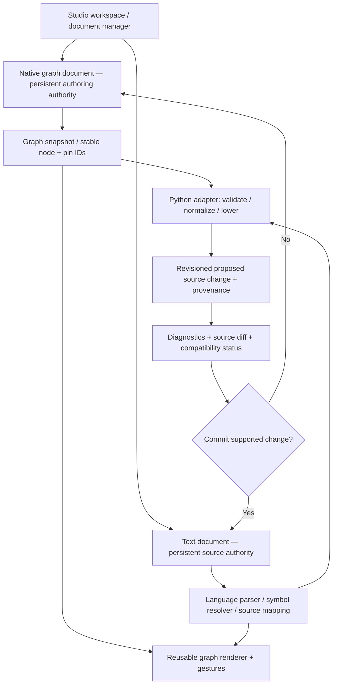

# Superior MI Studio — Architecture Review II
**Subject:** Graph authority, arbitrary authoring, partial code generation, and interchangeable visual/text programming  
**Baseline:** Superior MI Python Visual Programming Lab v2.50, supplied 30 October 2026  
**Status:** Design review, not an implemented migration

## Decision in one paragraph

Approach A should no longer be dismissed. Studio already has an editable and savable draft graph model, and the user's requirement to explore incomplete graphs is legitimate. But **graph-first programming** and **fully interchangeable editing of arbitrary existing Python** are different products with very different engineering costs. I recommend a staged, graph-first architecture with a persisted graph artifact, an explicit code-generation/diagnostic boundary, and scoped lossless source synchronization. At any moment an individual program region has **one active write authority**, even though it may be viewed and edited from either surface through validated transactions. Incomplete work is saved in the graph artifact, not silently discarded or committed into the Python program as if valid. This is Approach A with safeguards, not a second independently editable version of the program.

## 1. Corrections to the previous review

The previous review was too categorical in favor of source authority. The valid engineering argument for Approach A is the distinction among **authoring**, **saving a design**, **validation**, **emission**, and **running a program**. A graph with an unconnected node or incomplete subgraph can be a perfectly valid saved graph document and can have no valid emitted Python for that part. Unreal has distinct editing, Save, and Compile actions, and its compiler schedules/prunes nodes not needed for compiled execution; graph errors are separately reported on relevant nodes. This does **not** establish that every arbitrary connected graph is safe to compile or that dropping faulty nodes preserves intended Python behavior.

Three statements need precision:

1. **“Only translate the correct portions.”** Yes, but “correct” must mean *self-contained, complete, reachable according to declared entry points, sufficiently typed, and proven to preserve required control/evaluation effects*. It cannot mean “any nodes without a red warning.”
2. **“Save graph even if wrong.”** Yes. Save the entire structurally well-formed authoring document, including incomplete nodes, unresolved inputs, and isolated experiments. Distinguish authoring-document integrity from program validity. Broken serialized references should be repaired to explicit unresolved connectors or rejected as corrupt file structure rather than mistaken for intentional incomplete programming.
3. **“Let generated Python be invalid; linting will catch it.”** Python source *can* be invalid during ordinary editing. But using intentionally broken emitted Python as the **only persisted representation** loses the graph's connections, node identity, abandoned experiments, layout and intent. Linting is not a substitute for a persistent graph artifact, and `ast.parse` / `compile` cannot round-trip invalid code into the current source-graph projection.

## 2. What v2.50 actually provides

| Current owner | Confirmed behavior | Implication |
|---|---|---|
| `studio_native/model.py` | Editable `smi.dynamic-node-lab` JSON state, arbitrary draft node and edge manipulation within its prototype type/validation rules, `read_state`/`write_state`, and `transaction` | Already a graph-owned authoring *prototype*, not an executable semantic graph |
| `studio_native/semantic_contract.py` | `NodeDescriptor`, `PortDescriptor`, `EdgeDescriptor`, `GraphDescriptor`; `origin` may be `source`, `draft`, `resource`; validates/snapshots graph producer data | Reusable **read-only interchange and rendering contract**; not a mutable compiler IR |
| `studio_native/python_graph.py` | `PythonDocument(path)` reads disk bytes, parses AST, builds symbol tables and projects graph | Mature read-only source understanding, not robust incomplete-source parser or general decompiler |
| `studio_native/python_authoring.py` | Qualified source operations such as function/return/call/branch/loop/assignment transformations | Useful language-owned semantic operations and validation cases |
| `studio_native/python_edit.py` | Byte-preserving AST-span proposals and syntax validation | Good source transformation safety; no graph-owned whole-program compiler |
| `studio_native/source_editor.py` | In-memory edit submitted as valid Python proposal, then saved to disk before the graph is rebuilt | Valid source currently required for saving through the Studio text editor |
| `studio_native/gui.py` | `save_graph()` persists JSON, `save_python_editor()` persists Python independently; source preview rejects dirty text when graph operations are proposed | No integrated graph-owned-program ↔ editable-Python live synchronization |

Current `model.py` also includes prototype presentation control rows (sliders, previews, etc.), limited built-in types and graph-size bounds. Those should not become the semantics of Python execution. `GraphDescriptor` is intentionally read-only; adding mutation and codegen into it would violate an established separation. Prefer evolving the existing graph-document authority and adapter boundary rather than introducing another parallel graph registry.

A targeted local test run of `test_v211_draft_transactions`, `test_v240_python_program_construction`, and `test_v250_history_and_qt_watchdog` passed **39 tests**. This is not native Qt qualification and not proof of graph↔Python interchangeability.

## 3. Compare the actual options

### B. Source-first (existing direction)

- `.py`/document text is canonical; graph is a derived projection.
- Source-preserving graph changes are constrained to transformations the language adapter can prove.
- Incomplete experimental graph work needs a separate scratch document.
- Best for opening and editing arbitrary existing Python; lowest chance of a second code authority.
- Weakest at free-form Blueprint-style creation in the *same* programming graph.

### A1. Graph-first with generated, primarily read-only source

- Graph project is canonical and persisted; `.py` is generated output.
- Arbitrary experimentation is straightforward; unsupported subgraphs remain in the graph project.
- Saving graph is independent of emitting code, and failed generation cannot destroy the last known-good Python artifact.
- Graph → Python is difficult but bounded for a deliberately small node vocabulary.
- Fully editable text is *not* interchangeable: edits to generated files must be intentionally imported, and may not map back to the graph.

### A2. Graph-first with bidirectionally editable Python

- Graph project is canonical, but users edit the generated Python directly too.
- To retain the claim of interchangeability, source edits must either parse/merge back into the graph, become preserved opaque code regions, or trigger an explicit authority transition.
- Hard problems: expression evaluation order, lexical binding, comments/trivia, stable identities, partial syntax, graph-only draft islands, code-only constructs, cross-file edits, and conflict resolution.
- Highest complexity and largest semantic risk. It is not achieved by adding a Python pretty-printer to A1.

### C. Mixed-ownership program regions (recommended eventual form)

- A Studio project persists a graph design and ordinary source documents; neither is a disposable view.
- **One owner per editable programming region and per revision**, not a global free-for-all.
- Graph-owned regions support free authoring; text-owned regions preserve code exactly. A graph-owned region can be shown in an editable source view *only through a synchronization transaction*. Unknown source structures appear as editable opaque code nodes, not fabricated semantic wires.
- Reconciliation must be explicit when the same region changes independently in both representations.
- This is an incremental extension of A1 toward A2, while retaining B as the natural mode for existing files.

**Recommendation:** Build A1's graph-authoring and lowering kernel, backed by one shared document/revision framework. Support B for imported existing source. Add C region-level interoperability only after a measurable round-trip test proves it; do not pretend A1 has A2 parity.

## 4. Core architecture and ownership

The diagram has two *document kinds*, not two independently writable versions of the *same programming region*. For a graph-owned region, the graph is its source of truth; generated code is a versioned artifact synchronized by the adapter. For a source-owned region, text is authoritative and the graph is a projection, potentially with source-backed code islands. When converting ownership, use an explicit validated transaction and retain provenance.

**Separate responsibilities:**

1. **Document session:** identity, revision, text/graph snapshot, dirty state, save/undo history, provenance, conflict detection.
2. **Authoring graph model:** persisted nodes, ports, edges, ordering, regions, draft placeholders, stable identities, annotations and presentation references. The graph may be incomplete.
3. **Graph schema + node definition:** structural graph invariants, port cardinality, declared operation, data/control categories, default slots. Rules vary by target language and graph kind.
4. **Language semantic adapter:** scope resolution, effects, types where knowable, legal lowering, code islands, source import, diagnostics, source mapping.
5. **Emitter + validator:** graph IR → target-language code **only from qualified regions**; validate generated syntax; map diagnostics and output back to nodes.
6. **Editor views:** Qt text and graph presentation; gestures produce *intents*, not direct compiler decisions.
7. **Development tooling:** language servers, real Python runtime, linters, test runner, debugger; do not reimplement those engines.

## 5. Mandatory distinction: structural validity vs programming validity

A valid serialized graph may contain:
- disconnected experiments, unresolved required inputs, unreachable nodes, incomplete function bodies;
- deliberate sketch/placeholder nodes, comments and reroute points;
- type or symbol diagnostics, pending cross-file dependencies.

A structurally invalid graph contains corrupt references, duplicate identities, unknown document version, nonsensical port metadata, or links referring to deleted node IDs with no explicit unresolved connector. These should be rejected or repaired with explicit placeholder records so saving/reopening never loses intent silently.

The status of a graph region must distinguish:
- **Draft:** preserved graph, not yet eligible for emission.
- **Eligible:** complete graph lowering validated for the target language and export policy.
- **Generated / in sync:** current source corresponds to the graph revision and source-map hash.
- **Blocked:** mandatory dependency is unresolved; affected output should not be overwritten.
- **Diverged:** text and graph changed relative to common base; require reconciliation.
- **Stale:** source or dependencies changed since last successful generation.

Never use a single boolean `valid` to represent all of these facts.

## 6. What “generate only valid portions” must mean

**Example A — independent experiment:** An executable `calculate(a, b)` graph is complete. Another disconnected `sqrt` node is only a sketch. Save both into `.smi` graph document. Generate `calculate` into `.py`, leave the sketch persisted but ungenerated. Optionally flag the sketch as `Draft, excluded from generation`, *not* an error blocking code generation.

**Example B — incomplete controlling branch:** The function calculates a customer charge, but the `if eligible` branch has no condition or required effect path. Omitting that branch would change the user's intended business logic. Block generation for the affected function/entrypoint and preserve previously generated code unmodified. Other independent functions may remain eligible if import dependencies and cross-references are proven safe.

**Example C — wrong type but valid Python syntax:** `"4" + 2` parses successfully but raises at runtime. A linter or type checker may identify an error, but Python syntax validation alone does not prove correctness. Do not label a graph “semantically correct” based only on `compile()`. Preserve warnings/errors and let the user deliberately run code when appropriate.

**Example D — side effects:** Rewiring a call to `record_payment()` into two data consumers must not duplicate execution. Graph lowering needs explicit evaluation-order and value-sharing semantics, including temporary variables where required.

**Example E — invalid source text:** A user types an unclosed parenthesis. The source editor keeps it as an unsaved or saved text document and reports diagnostics. If it was derived from a graph-owned region, Studio must not silently re-import the invalid source as a different graph or overwrite its authoritative graph state.

**Example F — disconnected graph with no entrypoint:** Do not infer program order from left-to-right placement or a node's visual coordinates. Emission requires explicit function/module boundaries and scheduling rules. Unreachable nodes may be excluded only where the contract says they are not program behavior.

For partial generation, use *scope-level atomicity* first: complete functions or modules, not arbitrary node subsets. Require that dependencies and shared definitions are consistent. Do not patch half a function on a failed validation.

## 7. Graph-to-Python compiler design

A Python emitter is not a bytecode compiler. It is a **source generator**, followed by Python parsing/compilation checks and optional third-party diagnostics.

Recommended stages:

1. **Select an explicitly declared target:** Python version, module, function/entrypoint, generation policy.
2. **Normalize authoring graph:** validate ID integrity and interface metadata; identify draft-only elements.
3. **Resolve symbols and scopes:** arguments, locals, return sites, imports, closures, shadowing and explicit unsupported cases.
4. **Validate connections and dependency/effect edges:** type constraints, control placement, required inputs, value lifetimes, evaluation order, loops/branches.
5. **Build a language-aware structured representation:** statements, expressions, control regions, blocks, source spans; use the existing graph model as *input*, not codegen itself.
6. **Schedule operations:** control-flow first, data dependencies inside their legal control regions. Avoid heuristic left-to-right ordering.
7. **Generate bounded source:** use exact source preservation for source-owned/code-island regions; construct new source only for graph-owned regions.
8. **Parse/compile in the target Python version, without executing user code.** Detect exceptions and produce node-linked diagnostics. Lint/typecheck separately.
9. **Publish as a versioned source proposal:** diff, provenance, source-map, graph revision, target revision; atomic replacement only if base revisions match.
10. **Reparse and compare:** graph→code→graph semantic equivalence of supported constructs; preserve ungenerated graph content and presentation state separately.

`ast.unparse` is not a lossless formatting round-trip. Python's documentation warns that unparsed code need not equal original source. A concrete-syntax-tree/token-aware technique may be appropriate for localized Python editing, but adoption should follow a measured prototype, not precede it.

## 8. Round-trip and conflict handling

Bidirectional support must specify the edited unit:

- **Graph-owned:** edits to graph update persisted graph state immediately; preview source is generated from current qualified graph revision. Text modifications in that generated region become *proposed source changes*. Accept by parsing into equivalent graph operations, storing an exact code island, or explicitly converting region ownership to text. Reject only unrepresentable *synchronization*, never lose the text edit.
- **Source-owned:** text changes update the authoritative buffer; graph is a projection. Users may create independent graph scratch islands, but applying them to source is a validated merge operation.
- **Common-base divergence:** if graph and text both changed since the same source map revision, do not use “last writer wins.” Offer diff/merge with precise scopes, and allow saving both drafts without overwriting either.

The test is not merely `ast.parse(generated_code)`. It is **equivalence plus no silent loss of source text or graph intent**. Because Python is dynamic, full program-behavior equivalence is generally undecidable; rely on bounded transformations, AST/CST structure, effect checks, and tests appropriate to the supported subset.

## 9. Implementation cost / difficulty

| Capability | B source-first | A1 graph-first → generated code | A2 fully interchangeable graph/text |
|---|---|---|---|
| Graph experiments and disconnected nodes | Needs scratch graph | Natural | Natural |
| Import arbitrary existing `.py` without changing it | Natural | Difficult to preserve if graph is only authority | Very difficult |
| Emit complete simple straight-line Python | Existing bounded operations | Moderate | Moderate |
| Arbitrary branch/loop/function graph lowering | Not required for source projection | High | High |
| Side effects, exceptions, Python binding/evaluation semantics | Source already defines them | High | Very high |
| Preserve comments/formatting across text edits | Existing localized edits | Not relevant to purely generated output | Very high |
| Stable node IDs through text refactors | Presentation-matching problem | Easy within native graph | Hard after code edits |
| Two-way edits without data loss | Bounded source operations | Not provided | Highest risk |
| Add another language | New parser/adapter | New emitter/semantics | New emitter, importer, merge, semantic code islands |

A1 is not inherently harder than B at all tasks; A1 makes free-form creation *easier* while imposing a new lowering system. **A2 is the expensive objective**, because it compounds A1's emitter with a lossless, editing-aware source importer and conflict-handling mechanism. Any workload multiplier without a bounded feature inventory is misleading. For planning, treat A1 as a major new compiler/editor subsystem and A2 as a second, separately qualified program until evidence permits consolidation.

## 10. Specific refactoring guidance for v2.50

1. **Retain `semantic_contract.py` as immutable graph description.** Do not transform it into an editable state registry or compiler; enrich descriptors only when qualified by real adapter requirements.
2. **Evolve `model.py` (the current draft authority) deliberately.** Move from untyped presentation prototypes toward versioned, typed programming graph documents with stable identities, explicit operation schemas, scopes, placeholders and persistent annotations. Keep sliders/audio previews as UI data, not executable semantics. If the one module becomes unwieldy, split only along proven boundaries (document structure, validation, authoring transactions), avoiding an alternate state registry.
3. **Reuse `authoring_contract.py`, `operation_catalog.py`, and language adapter operations.** There should be one node/capability definition per language, used for creation search, validation, inspection and generation. Reuse `python_authoring.py` safety tests and its semantic decisions where applicable.
4. **Evolve `PythonDocument` to parse source snapshots rather than only disk files.** Support source buffer revisions, including incomplete text in the editor; keep AST-based semantic projection for syntactically valid snapshots. Assess an error-recovering parser such as Tree-sitter *only after* a contained parsing prototype proves it helps.
5. **Keep `python_edit.py` as a guarded transformation/write layer.** The future emitter should produce revisioned proposals consumed by that pipeline; avoid UI code or graph rendering writing `.py` directly.
6. **Separate save operations:** `Save Graph`, `Update Generated Source`, `Save Text`, `Validate`, `Run`. Provide convenient keyboard commands without conflating their semantics.
7. **Keep `presentation_state.py` and Qt view routing outside program semantics.** Graph positioning, collapse, reroute control points and cameras must not determine execution order.
8. **Add graph/code provenance maps:** graph node and pin IDs ↔ emitted source ranges or code islands, target revision hashes, producer adapter/version. If mapping is uncertain, mark it, do not claim identity.
9. **Do not add language 2 until graph programming gates pass for a bounded Python subset.** But test the adapter-neutral data contracts with a tiny non-Python mock to prevent Python-specific assumptions leaking into Qt and documents.

## 11. A staged feasibility experiment — the next engineering decision

Before a full migration, build and test one **narrow vertical slice**, isolated from the normal source editor yet reusing the existing graph rendering and draft-save architecture:

- Graph-owned Python document with stable IDs; create two functions and one call; emit valid `.py`.
- Add a disconnected experimental node and an unresolved branch; graph still saves/reopens, generated source remains deterministic, affected function is explicitly blocked.
- Edit a function's parameter in the generated text; import it back as an equivalent graph change with preserved node identity and no lost comments.
- Edit unsupported Python syntax in a region; preserve it as a code island or refuse synchronized import while keeping the text intact.
- Edit text and graph independently from a shared base; conflict must be detected, not silently overwritten.
- Verify a side-effecting call is executed once when two consumers reference its result.
- Confirm codegen validity, source map, undo/redo, crash/reopen, and host Qt interactions.

The vertical slice needs separate commands for save and generate and an explicit compatibility status per region. It must not route new graph-authored code through fabricated `PythonDocument` AST nodes simply to satisfy the current source-first APIs.

**Go / no-go:** If the slice reliably handles independent drafts, safe whole-function emission, and scoped text synchronization, adopt the graph-owned mode. If source-import conflicts or code islands are unmanageable, retain graph-owned creation with generated read-only code while continuing B for editable existing Python. Do not claim full interchangeable editing until it has earned that description.

## 12. Architectural verdict

The correct goal is **not** that every graph can be translated into every programming language. The correct goal is that Studio never loses a developer's work and can translate *explicitly qualified* program regions safely, with exact diagnostics when it cannot. Graphs may freely contain sketches and incomplete programming elements; those are saved in graph documents rather than forced into `.py`.

My recommendation has shifted from “reject A” to **“prototype A as a first-class document authority; stage its interchangeability rather than promising it.”** Eventually the IDE should support both graph-owned and source-owned documents through one revisioned workspace and a single semantic adapter per language. Never let both representations silently overwrite the same region. That is how Studio can gain Blueprint's creative freedom without sacrificing the power of a conventional IDE.

## Sources

### Inspected local v2.50 code

- `studio_native/model.py` — draft state, validation, transaction, JSON read/write
- `studio_native/semantic_contract.py` — normalized graph descriptors and origin selection
- `studio_native/python_graph.py` — disk-authoritative AST projection
- `studio_native/python_authoring.py`, `source_connection.py`, `python_edit.py`, `source_editor.py` — qualified source edits and transforms
- `studio_native/gui.py` — independent draft/source save flows, source dirty state, review dialogs
- `docs/PYTHON-FIRST-READINESS-GATE.md`, `docs/V230-OPERATION-SCHEMA-AND-FUNCTION-BOUNDARIES.md`

### External design sources

- [Epic: Blueprint Compiler Overview](https://dev.epicgames.com/documentation/en-us/unreal-engine/compiler-overview-for-blueprints-visual-scripting-in-unreal-engine)
- [Epic: Blueprint Graph Editor](https://dev.epicgames.com/documentation/unreal-engine/graph-editor-for-the-blueprints-visual-scripting-editor-in-unreal-engine)
- [Epic: Blueprint Compiler Results](https://dev.epicgames.com/documentation/en-us/unreal-engine/compiler-results-in-the-blueprints-visual-scripting-editor-for-unreal-engine)
- [Epic: Blueprint Editor Menu (Save vs. Compile)](https://dev.epicgames.com/documentation/en-us/unreal-engine/menu-for-the-blueprints-visual-scripting-editor-in-unreal-engine)
- [Epic: Blueprint Graphs and Graph Types](https://dev.epicgames.com/documentation/unreal-engine/graphs-in-unreal-engine?lang=en-US)
- [Microsoft: Language Server Protocol and in-memory text authority](https://learn.microsoft.com/en-us/visualstudio/extensibility/language-server-protocol?view=vs-2022)
- [Python: `ast` documentation and unparse limitations](https://docs.python.org/3/library/ast.html)
- [Tree-sitter: error-recovering incremental parser](https://tree-sitter.github.io/)
